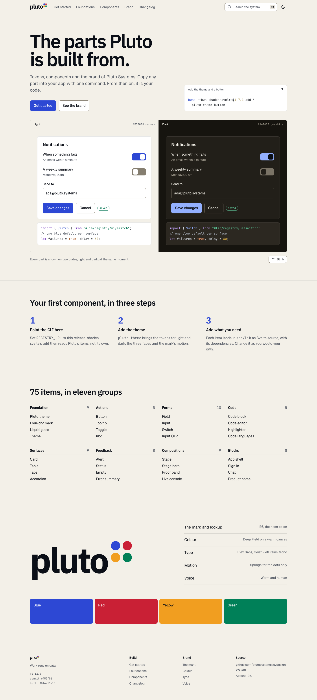
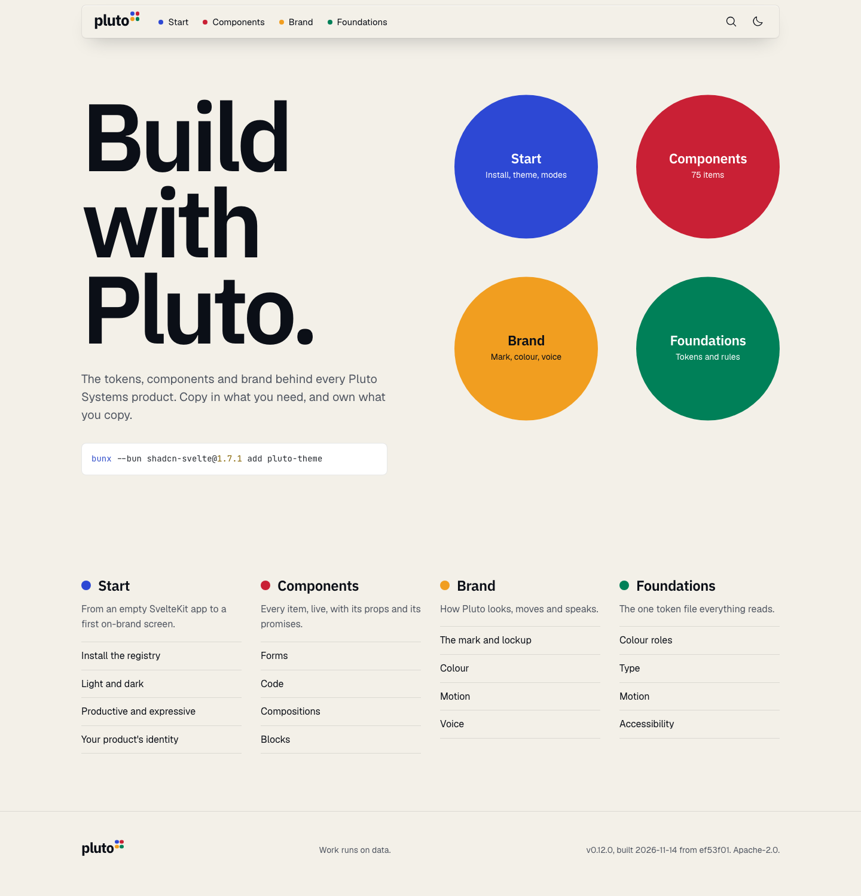
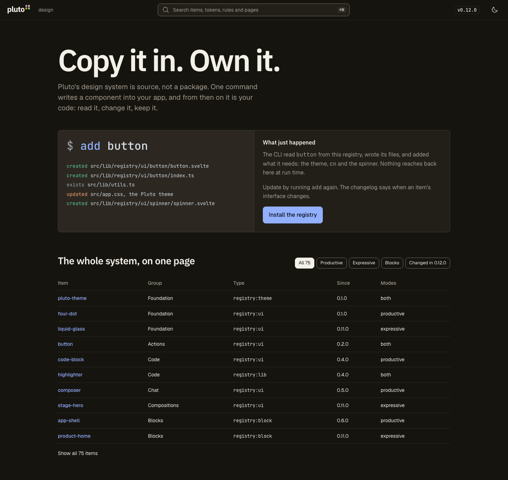

# The design site

- **Status:** complete
- **Date:** 2026-11-14
- **Author:** a researcher, at the design lead's request, for the owner. The design lead writes specification `015` from it.
- **Question:** What should this system's public design site be? It must explain how to build with the system and explain the Pluto Systems brand. It must fold in today's item pages and the `/identity` exhibit. The workbench goes. The owner's bar is to "compete with Google".
- **What would answer it:**
  - an inventory of today's app, tests and deploy;
  - a study of the best public design-system and brand sites;
  - three visual directions, built as throwaway prototypes and screenshotted;
  - a sitemap, a map from every old URL to its new place, and the owner's questions.
- **What it blocks:** specification `015`, the design site, which ships in 0.12.0 with `013` and `014`.

## In short

- **Today's app is a catalogue, not a site.** It has 137 prerendered pages: a home page that lists all 75 items, 75 item pages, 44 frameless views, 16 exhibit pages and the workbench. It has no getting-started guide, no foundations pages, no brand section, no search and no changelog page.
- **The best sites share four habits:**
  - two ways in, one for people who design and one for people who build;
  - component pages split into when, what, how and who;
  - tokens named and explained by their job;
  - copy-to-install everywhere.
- **The gaps worth beating:**
  - Few sites show every example live in both themes.
  - None ties an item's status, changelog and tests together on one page.
  - Public brand sections are thin or gated: Google's is behind a sign-in.
  - shadcn-svelte documents registries only lightly.
- **Three directions were built and screenshotted** in both themes, at 1440 and 390 px:
  - **A, Plates.** Every specimen sits on two plates, light and dark, side by side. A Blink control lays one over the other. The name comes from how Pluto was found: Tombaugh compared two photographs of the same sky.
  - **B, The mark is the map.** The four dots become the four doors of the site, and each section opens on its door's colour field. It is expressive and poster-scale.
  - **C, The manual.** Source first. A three-pane reference with a "files you will own" panel on every item, and brand figures drawn to measure.
- **Recommendation: A, Plates,** with two borrowings: C's "files you will own" panel, and C's figures drawn to measure on the brand pages.
  - It turns §2.3's promise ("every item has a page that shows it, in both themes") into the site's signature.
  - It keeps product pages quiet and saves the four colours for owned moments, as C2 says.
  - It carries today's tests with the fewest changes.
- **Sitemap, top level:** Home `/`, Get started `/start/`, Foundations `/foundations/`, Components `/items/`, Brand `/brand/`, Changelog `/changelog/`.
  - `/items/<name>/` and `/view/…` keep their URLs.
  - `/identity/…` gets 301 redirects to `/brand/…`.
  - `/workbench/code/` is removed.
  - The redirects live in a `_redirects` file, which Cloudflare's static assets read.
- **The main test risks:**
  - the home page's keyboard walk, which pins its stops today;
  - the lockup's accessible name;
  - `previews.test.ts`, which pins the `(site)` route group's folder;
  - the install command string;
  - doubled `data-testid`s, if a plate's twin is live.
- **The building turned up four things a specification must handle** (EXECUTED):
  - The theme has no way to make a subtree light.
  - The expressive mark rule reaches into a light island.
  - An unlayered element rule beats a field's legend.
  - Token reads must happen at the element, not at the root.
- **Eight questions for the owner**, each with options, the recommended one first: the direction, the name and domain, the install URL, downloads, the old exhibit, the URL word for components, how the release is shown, and machine-readable pages.

## How to read this memo

Every claim carries a label.

- **EXECUTED:** run and seen in this research, on 2026-11-14, on macOS (Darwin 25.5.0, arm64), with Bun 1.4.4 and Node 22.14.0, driving the Chromium of the repository's pinned Playwright 1.64.1.
- **READ:** a source says so. Local sources are this repository's working tree on 2026-11-14 (`main` at `ef53f01`, with the uncommitted `013` and `014` drafts and workbench), cited by path. Another session was changing tests and scripts for `014` while this was written (`pages.ts`, `keyboard.spec.ts` among them), so `015` reads them again before it counts anything. Web sources were read on 2026-11-14 and are linked.
- **INFERRED:** reasoning from the above.

**Terms used here.**

- A **plate** is a framed specimen painted in one theme.
- A **twin** is the other theme's plate of the same specimen.
- **Blink** lays the two plates over each other in one frame, swapping on a press.
- A **door** is a top-level section of the site.
- A **light island** is a subtree painted in the light theme inside a dark page.
- **IA** is information architecture: how a site's pages are grouped and named.

## 1. What the owner asked

- "also apart of 0.12.0, I want to build a brand site or a design site that explains how to build with the design system, and explains the pluto system brand. we can also drop the workbench/code/ app" (READ, `decisions.md`, 2026-11-14).
- The site lives in this repository. Constitution §3 now reads that this is not a marketing site and that it "hosts one public design site" (READ, `constitution.md`).
- It is public, and nothing internal goes on it. It deploys on Cloudflare (READ, `decisions.md`).
- On the item pages and `/identity`: "fold into site, but we need to think bigger and develope something great, use the front end design skill to help." The item pages become the component documentation. The exhibit's settled answers become the brand section. The exhibit's record stays in `context/` (READ, `decisions.md`).
- §2.3 still binds: "Every item in the registry has a page that shows it, in both themes" (READ, `constitution.md`).

## 2. What exists

### 2.1 The routes

Five route groups, 137 `+page.svelte` files (EXECUTED, a count of `src/routes`).

| Group | Pages | What it is |
|---|---|---|
| `(site)` | 76 | The catalogue at `/` and one page per item at `/items/<name>/`. Header: the lockup (with the page's one entrance) and the theme toggle. Footer: `app-shell-footer` with the lockup, "Work runs on data." and the build facts. |
| `(view)` | 24 | Frameless block views at `/view/<block>/<state>/`, shown in the block viewer's iframe on an item page. |
| `(shell)` | 20 | Views that render their own `main`: the six `app-shell` views, `product-home`, and 13 composition views under `/view/compositions/`. |
| `(identity)` | 16 | The exhibit: `/identity/` and one page per question, plus `compose`. It loads six candidate font packages in its layout. |
| `(workbench)` | 1 | `/workbench/code/`, the code-palette instrument. Never released. |

- The site's **home** groups the 75 items into eleven groups (foundation, actions, surfaces, feedback, forms, code, data, navigation, chat, compositions, blocks). Each card shows the item's type, its title, its description and a full install command (READ, `src/routes/(site)/+page.svelte`, `+page.server.ts`). The screenshot `2026-11-14-the-design-site/today-catalogue-desktop-light.png` shows it.
- An **item page** is assembled from a few preview components (READ, `src/lib/preview/`):
  - `item-header`: the type and name as a mono eyebrow, the title, the description and the install command;
  - `preview-section`: titled sections;
  - `specimen`: captioned examples;
  - `block-viewer`: an iframe of a view with width presets, a theme that follows the page, "open alone" and a code view;
  - `contrast-table` and `font-page`.

  Titles and descriptions come from `registry.json` through `(site)/items/+layout.server.ts`.
- **Themes.** Each page holds exactly one `ThemeScript`, rendered by the `(site)` or `(view)` layout. A page shows one theme at a time and the toggle flips it (READ, the layouts; `tests/e2e/theme.spec.ts`).
- **Every route is prerendered** with `trailingSlash = "always"` (READ, `src/routes/+layout.ts`). The adapter is `@sveltejs/adapter-static` 4.0.0 (READ, `vite.config.ts`, `package.json`).
- **The error page** is the `page-states` block's (READ, `src/routes/+error.svelte`).

### 2.2 The registry

- 75 items in eleven groups (EXECUTED, read from `registry.json`):

  | Group | Items |
  |---|---|
  | foundation | 9 |
  | actions | 5 |
  | surfaces | 9 |
  | feedback | 8 |
  | forms | 10 |
  | code | 5 |
  | data | 2 |
  | navigation | 6 |
  | chat | 4 |
  | compositions | 9 |
  | blocks | 8 |

- Every item declares `meta.modes`.
  - Productive only: most items.
  - Both modes: the theme, fonts, `utils`, `read-token`, `button`, `highlighter`, `use-highlighted-code`, `code-languages` and `is-mobile`.
  - Expressive only: `liquid-glass`, the nine compositions and `product-home`.
- Items also carry `meta.since` and `meta.group` (READ).
- The built registry JSON is committed under `static/r/` and `static/v<version>/`. So the site already serves it at `/r/…` and `/v0.x.y/…` (EXECUTED: `build/` holds `r`, `v0.4.0` … `v0.11.0`).
- **The install command** points the CLI at a raw GitHub URL pinned by tag:

  ```
  REGISTRY_URL=https://raw.githubusercontent.com/plutosystemsco/design-system/v<version>/static/r bunx --bun shadcn-svelte@1.7.1 add <item> -y
  ```

  (READ, `src/lib/preview/install-command.svelte`; `decisions.md`, "The registry is served from GitHub").
- `registry.json`'s `homepage` is the GitHub repository (READ).

### 2.3 The tokens and the brand assets

- **One token file,** `tokens/pluto.tokens.json`. Its top-level groups are `primitives`, `themes`, `code`, `radius`, `spacing`, `type`, `motion`, `mark`, `line`, `focus`, `elevation`, `expressive` and `contrast`. `expressive` holds `display` (four steps: display, section, proof, poster), `motion`, `size`, `gutter`, `field` and `glass` (READ).
- **The built theme** emits every role on `:root` and again on `.dark`, 98 variables in each (EXECUTED, read from the built CSS). It has no class that makes a subtree light (EXECUTED; see §6.1).
- **Brand assets, as code:**
  - `four-dot`: `FourDot` and `Lockup`. E6: the mark at 0.87 of the word, 0.10 em from it, its top 0.90 em above the baseline.
  - The three font items: IBM Plex Sans for headings and display, Geist for the body, JetBrains Mono for code.
  - The four fields and `surface-plain`.
  - `glass`, frost only.
  - `type-poster`, up to 160 px.
  - `--ease-spring`, for the dots only.
  - `mark-entrance` and `mark-reveal`.

  (READ, `011`, `four-dot`, the built CSS.)
- **Brand assets, as files:** none. The repository holds no SVG, PNG or favicon outside the registry JSON (EXECUTED, a search of `static/` and `src/`). The lockup is set in type, so a downloadable lockup needs its glyphs outlined (INFERRED).
- **Compositions:** `stage`, `stage-card`, `marketing-bar`, `stage-hero`, `proof-band`, `live-console`, `name-strip`, `cta-band` and `marketing-footer`, and the `product-home` block (READ, `010`, `012`). The site can be built largely from them (INFERRED).

### 2.4 The tests that pin today's URLs and pages

The last full runs were: unit 892, e2e 1966 passed and 4 skipped, smoke 111 (READ, `handoff.md`). The URL coupling:

| Where | What it pins | What a new site breaks |
|---|---|---|
| `tests/e2e/pages.ts` | `PAGES = ["/", …/items/<name>/]`; the views from `BLOCK_VIEWS` and `COMPOSITION_VIEWS`; view stop lists | New pages must join a list, or no suite visits them |
| `keyboard.spec.ts`, "the catalogue" | `/` has exactly `3 + 75` stops: the lockup link, the toggle, each item link in order, the source link; the first stop is named "Pluto Systems design system" | Any new home page. The test moves to the catalogue's new page or is rewritten |
| `four-dot.spec.ts` | The header lockup link's accessible name, "Pluto Systems design system" | The site's name, if it changes |
| `theme.spec.ts` | Every page in `PAGES` and every view holds the theme script exactly once | A new layout must keep exactly one |
| `axe.spec.ts` | `/` and 002's item pages at 1280; the other item pages and the views at 360, 768 and 1280 | New pages need axe at all three widths |
| `viewer.spec.ts` | The install command string, with the raw GitHub URL and `v${version}` | A new install URL (question 3) |
| `tests/unit/previews.test.ts` | Each item has `src/routes/(site)/items/<name>/+page.svelte` | Renaming the `(site)` group, or moving item pages |
| `tests/unit/blocks.test.ts` | Views live under `(view)` or `(shell)`, and no other `+page.svelte` sits under `view/` | Moving views |
| `tests/unit/workbench.test.ts` | The workbench's functions | Removed with the workbench, but see §6.5 |
| `tests/smoke/*` | `/r/…` on a local server, not the site's pages | Nothing (EXECUTED, a search of the smoke files) |

- `identity.spec.ts` tests the `app-shell` views (`008`), not `/identity`. Its name is historical (READ). The exhibit itself has no tests (READ, `handoff.md`).
- The literal lint reads only files that registry items carry (READ, `scripts/lint-literals.ts`, `registryFiles`). The site's own routes are not linted today.

### 2.5 The deploy

- `wrangler.jsonc` names the worker `pluto-design-system` and serves `./build` as static assets. It has no worker script (READ).
- `vite.config.ts` reads `WORKERS_CI_COMMIT_SHA` for the footer's commit. So the build runs in Cloudflare's Workers CI (INFERRED).
- Cloudflare's static assets read a `_redirects` file placed in the assets directory (for SvelteKit, `static/`) (READ, [developers.cloudflare.com/workers/static-assets/redirects](https://developers.cloudflare.com/workers/static-assets/redirects/), 2026-11-14):
  - one rule per line: source, destination, code;
  - codes 301, 302, 303, 307 and 308;
  - one splat per source;
  - up to 2,000 static and 100 dynamic rules.
- That page does not say how trailing slashes interact with `html_handling`. A redirect test must run against the deployed worker, or against `wrangler dev` (INFERRED).

## 3. Prior art

Read on 2026-11-14 by a research helper, from the pages linked. Each is described in our words; no code or text is copied. Where a page would not render without script, that is said.

### 3.1 Design-system sites

- **Material Design 3** ([m3.material.io](https://m3.material.io)).
  - Every page fetched came back empty without JavaScript. That is a lesson in itself: crawlers and agents cannot read it.
  - Search results show its structure: Foundations, Styles and Components. Each component has four tabs: Overview, Specs, Guidelines, Accessibility.
  - Expressive is presented as a research-backed layer, folded into the same component pages as labelled variants ([design.google, expressive research](https://design.google/library/expressive-material-design-google-research)).
  - Its web library says it is in maintenance mode ([material-web.dev](https://material-web.dev/)). The guidance and the code have drifted apart. (READ)
- **IBM Carbon** ([carbondesignsystem.com](https://carbondesignsystem.com/)).
  - Separate paths for designers and developers.
  - Component pages have four tabs: Usage, Style, Code, Accessibility.
  - A small live demo at the top; the rest is mostly images.
  - Its accessibility tab has a **testing-status table** per component, tied to a version.
  - Productive and expressive are named type sets: a 14 px base for dense UI, a 16 px base with fluid display steps for pages.
  - Token tables give each token's role in words.
  - The brand, the IBM Design Language, sits above it on a separate site, which did not render when fetched. (READ)
- **GitHub Primer** ([primer.style](https://primer.style/)).
  - The cleanest split: Product UI, Brand UI (marketing components such as Hero, River and Bento), and a Brand Toolkit on its own site ([brand.github.com](https://brand.github.com/)).
  - The toolkit covers identity, foundations (colour, logo, type), graphic elements, motion and voice.
  - Component status (Experimental, Ready, Deprecated) is shown per platform.
  - Token tables carry a copy button on each variable name. (READ)
- **Shopify Polaris.** `polaris.shopify.com` now redirects to [shopify.dev/docs/api/polaris](https://shopify.dev/docs/api/polaris). The guidance that made Polaris famous is no longer prominent; it reads as API reference. A strong documentation brand dissolved into a portal. (READ)
- **Atlassian** ([atlassian.design](https://atlassian.design/)).
  - Four entry paths: designers, developers, content designers, and "with AI".
  - Themes go beyond colour to density and reduced motion.
  - Release phases appear in the side navigation.
  - **Each component has a Changelog tab.**
  - Voice guidance is situational: each trait has "when to say more, when to say less". This was the best voice writing found.
  - The brand pages did not render; logos sit under Foundations. (READ)
- **Apple Human Interface Guidelines.**
  - The HTML needs script. Its JSON data endpoint worked ([HIG data](https://developer.apple.com/tutorials/data/design/human-interface-guidelines.json)).
  - Six collections: Getting started, Foundations, Patterns, Components, Inputs, Technologies.
  - Platform notes sit inside each page rather than behind a switcher.
  - **Every page ends with a dated change log.**
  - The best prose in the set. It has no live examples and nothing to copy. (READ)
- **Vercel Geist** ([vercel.com/geist](https://vercel.com/geist/introduction)).
  - Each colour step is tied to a job: steps 100 to 300 are backgrounds, 400 to 600 are borders, and so on.
  - Each type style says where to use it.
  - **Every page is also served as Markdown** (`.md`, or `Accept: text/markdown`).
  - A brands page gives logotypes with clear space, and lists of what you may and may not do. (READ)
- **shadcn/ui** ([ui.shadcn.com](https://ui.shadcn.com/docs/installation)).
  - A component page holds:
    - a live preview with a code toggle;
    - CLI and manual install tabs, with package-manager tabs and copy buttons;
    - usage, examples and an API table;
    - a sticky table of contents;
    - "Copy page".
  - Blocks show a live preview, a file tree and one `add` command.
  - The registry docs cover namespaces, auth and an MCP server.
  - A monthly changelog with RSS. (READ)
- **shadcn-svelte** ([shadcn-svelte.com](https://www.shadcn-svelte.com/docs/registry)).
  - Mirrors shadcn/ui.
  - Registries are marked "currently experimental". `registry build` writes to `static/r`.
  - The CLI page describes `add <url>` but gives no worked example.
  - It has no namespace, auth or MCP pages. (READ)

### 3.2 Brand sites

- **Google:** the brand resource centre redirects to a partner portal behind a sign-in ([partnermarketinghub.withgoogle.com](https://partnermarketinghub.withgoogle.com/brands/google/overview/)). It has no public guidance on logo, colour or type. (READ)
- **Spotify for Developers** ([developer.spotify.com/documentation/design](https://developer.spotify.com/documentation/design)). The most useful public brand page found. It sets exact numbers: clear space as a share of the icon, minimum sizes, which logo colour goes on which ground, corner radii, attribution and co-branding rules, and zip downloads. (READ)
- **Stripe** ([stripe.com/newsroom/brand-assets](https://stripe.com/newsroom/brand-assets)). Minimal: three wordmark colours and no others, a logo kit and a badge. (READ)
- **Uber** (brand.uber.com) and **Mozilla** (brand.mozilla.com) came back empty without script. (READ)

### 3.3 What the best ones share, and what is worth beating

- **Two ways in.** The best sites give designers and builders separate starts, and put foundations under components (Carbon, Atlassian, Apple) (READ).
- **Pages split into when, what, how and who.** Usage, specs and tokens, code and props, accessibility (Material, Carbon, Primer, Atlassian) (READ).
- **Tokens explained by their job, each with a copy button** (Geist, Carbon, Primer) (READ).
- **Copy-to-install wins for builders.** For a registry the documentation *is* the distribution channel (shadcn) (READ).
- **Worth beating:**
  - **Live examples in both themes.** Carbon and Apple are mostly pictures, and Polaris's new pages are code only (READ). A site where every example is live, in both themes, at once, would beat them (INFERRED).
  - **Status, changes and tests on one page.** Carbon has a testing table, Apple a dated log, Atlassian a changelog tab. None ties all three together (READ). This repository already knows all three for every item: `meta.since`, the changelog and the test suites (INFERRED).
  - **A complete public brand section.** Google's is gated, and Uber's and Mozilla's are unreadable without script (READ). A prerendered brand section in this repository, with exact numbers, is ahead of them by default (INFERRED).
  - **Motion, voice and imagery shown, not told.** No site found shows them as live specimens (READ).
  - **A worked registry install for Svelte.** shadcn-svelte leaves it thin (READ).
  - **Pages agents can read.** Material, Uber and Mozilla cannot be read without script; Geist serves Markdown (READ). This site is prerendered already (READ, §2.1).
- **Drift is the failure mode.** Material's web code is in maintenance, and Polaris's guidance faded (READ). This site is built from the same source as the registry, so its examples cannot drift from the items (INFERRED).

## 4. What the site must explain

### 4.1 How to build with the system

Each line names the page that carries it and the source that settles it.

- **Install.** Point `REGISTRY_URL` at a release, then `bunx --bun shadcn-svelte@1.7.1 add <item>`. Dependencies resolve. The app owns the source (constitution §1, §4.1; `001`).
  - A worked example from an empty SvelteKit app, with the files each step writes.
  - Pinning: a tag pins a release; `main` follows the latest (`decisions.md`, "The registry is served from GitHub").
- **The theme item.**
  - `pluto-theme` writes the tokens into the app's CSS.
  - Its global class names (`glass`, `surface-plain`, `field-1` … `field-4`, `busy-edge`, `action-press`, `type-*`) can collide with an app's own (CHANGELOG 0.11.0).
- **Tokens.** One file, roles not values, light and dark. The page shows each role in both themes with its contrast measured (`001`, `011`). The token table can be generated from the token file and the contrast rows (INFERRED).
- **Light and dark.**
  - The `theme` item: a head script, a store on the key `pluto-theme`, and a toggle (`005`).
  - Its known limit: with scripts off, a dark-system reader gets the light theme (`research/2026-11-14-the-theme-with-scripts-turned-off.md`).
- **Productive and expressive.**
  - `data-mode`, what each mode allows, and the lint profile (L22) (`009`).
  - Fields and glass on expressive pages only, and R25's rules (`011`).
  - `type-poster` for launches only (K3).
- **Your product's identity.**
  - A product sets its logo, its name and its copy; everything else is shared (`decisions.md`, "One system, many products").
  - The `logo` snippet, the wordmark fallback, and the optional "A Pluto Systems product" endorsement (`008`).
- **Compositions and blocks.**
  - Blocks are pages installed with one `add`. Compositions are expressive sections (`003`, `010`, `012`).
  - The `product-home` block as the worked example of an expressive page.
- **Code highlighting.**
  - In 0.12.0: tree-sitter at prerender and in the browser, Shiki as the fallback, Meridian's roles, Tombaugh's colours, and the white light-mode code ground (`013`, `014`, drafts).
  - The page shows each role in both themes and names the languages.
- **Accessibility promises and limits.**
  - WCAG 2.2 AA in both themes; every interactive item works by keyboard (§4.4).
  - Checked in Chromium by axe and a keyboard walk.
  - Not checked: Firefox, Safari, iOS Safari, screen readers (`handoff.md`).

  Saying the limits plainly is Carbon's best habit (§3.1).
- **Changes and upgrading.**
  - The changelog, newest first, with interface changes marked (§6.3 of the constitution, CHANGELOG).
  - Per item: since, changed in, and the lines that touched it.
  - How to re-run `add` to update, and what an interface change means for an app that owns its copy.

### 4.2 The brand

Only settled decisions go on the site (READ, `decisions.md`, 2026-11-01 to 2026-11-14).

| Page | What it says | Settled by |
|---|---|---|
| Overview | Pluto Systems: a workspace suite on one governed data layer. "Work runs on data." An open platform with a branded suite (A4): Pluto Docs, Pluto Sheets; open-source cores keep their names, as `vfs` does | "The identity is commissioned"; A4 |
| The mark and lockup | Four dots in N1's order and spacing (dot .30 em, gap .08 em), knowingly close to Google's at a glance. E6: risen colon, lowercase bold "pluto", mark at .87, .10 em from the word, top .90 em above the baseline. A logo, exempt from the 3:1 graphic rule. 20 px minimum lockup. Dark: paper on product screens, the lifted four on expressive pages | N1, E6, `001`, `008`, `011` |
| Colour | Deep Field's four colours and their lifted and text tones. The warm canvas `#F3F0E8` and graphite `#16140F`. C2: products neutral, the four together only in owned moments. One yellow everywhere, never the only signal. Brand red kept apart from error red | B3, C2, I5, "one yellow", `011`, `012` |
| Type | Plex Sans for headings and display, Geist for the body, JetBrains Mono for code (D1). The display ladder, with `type-poster` to 160 px for launches only (K3) | D1, K3, `009`, `011` |
| Shape, light and glass | One 8 px radius, round only for dots (H1). Product screens flat: hairlines, no shadow, no glass (I5). Liquid glass, frost only, on expressive pages only, over fields, opaque under reduced transparency, forced colours or no backdrop filter (I9; "Frost only"). The four fields and what they may hold (R25) | H1, I5, I9, "Frost only", `011` |
| Motion | J2: motion answers the visitor. J4: springs for the dots only. One entrance per page; the 200 ms reveal | J2, J4, `006`, `008`, `011` |
| Imagery | All four sanctioned: product truth, figures, people at work, abstract data. Each page picks the one that fits its job | M1 to M4 |
| Voice | Warm and human (L3): the work, not the tool. The writing rules: short sentences, one idea each, sentence case, no arrows in copy | L3; `decisions.md`, "Two writing and furniture rules" |
| Products and icons | Identity only per product; the endorsement. G5's tile: flat colour, white Phosphor glyph (ink on yellow), two apps per hue, radius 8, 6, 4 or 2 px by size | A4, G5, "One system, many products" |

**Still open, and said so on the site or left off it:**

- **Product icons.** G5 is chosen, but its specification has not been written. The handoff lists it as next (READ, `handoff.md`). The page can show the rule; the icons themselves wait.
- **A signature device.** The owner set it aside: "None of F1 to F10 works" (READ, 2026-11-06). The site shows none.
- **Downloadable assets** do not exist as files (§2.3). See question 4.

## 5. Three directions

All three are built on this system's own tokens: the built `pluto-theme` CSS, the three faces, the four fields, `glass` and `type-poster`. Each was built as throwaway HTML, outside the repository, reading the repository's built stylesheet and fonts read-only. The only literals are the code colours, taken from the `013` (Tombaugh) and `014` (white light ground) drafts, which are not yet in the token file. Each direction has a home page, a component page (Button) and a brand page.

Every page was screenshotted at 1440 × 900 and 390 × 844, in both themes, full page, with reduced motion (EXECUTED). At 390 px no page scrolls sideways: `scrollWidth` is 390 on all nine (EXECUTED). The 36 screenshots are in [`2026-11-14-the-design-site/`](./2026-11-14-the-design-site/), named `<direction>-<page>-<width>-<theme>.png`.

The specimen copy in the screenshots is sample text, including the address `ada@pluto.systems`. It does not assert a domain.

### 5.1 Direction A: Plates



**The idea.** Tombaugh found Pluto by comparing two photographic plates of the same sky. Every specimen on this site sits on two plates, light and dark, side by side, at the same moment. A Blink control lays one over the other for close comparison. §2.3's promise becomes the thing a visitor sees first.

**Plan.**

- **Colour:**
  - canvas `#F3F0E8` and graphite `#16140F`;
  - ink `#0B0F17`;
  - plates on `card` (white, `#221F19`);
  - links and actions in the theme's blue (`#2D48D4`, `#93B0FF`);
  - the four colours only in the mark and in one owned moment on the home page.
- **Type:**
  - Plex Sans 600 at `type-display` for the home headline, and at the section step for page titles;
  - Geist for body and interface;
  - JetBrains Mono only for code, hex values and the install line.
- **Layout:**
  - a sticky bar (lockup, five sections, search, theme);
  - documentation pages with a left rail and a content column;
  - plates span the column;
  - left-aligned throughout;
  - on a phone the two plates stack, light above dark.

  ```
  [lockup] Get started Foundations Components Brand Changelog   [Search ⌘K] [theme]
  ------------------------------------------------------------------------------
  The parts Pluto           | add pluto-theme button   (code)
  is built from.            |
  [Get started] [See the brand]
  +---------- Light ----------+---------- Dark -----------+
  |   the same live specimen  |   the same live specimen  |
  +---------------------------+---------------------------+
  Every part, on two plates.                        [Blink]
  ```

- **Principles:**
  - The plates are the one bold thing.
  - Everything around them is quiet, productive and flat.
  - The brand gets one moment: the lockup at poster size over the four fields.

**Screens:**

- [home](./2026-11-14-the-design-site/a-plates-home-desktop-light.png) ([dark](./2026-11-14-the-design-site/a-plates-home-desktop-dark.png), [phone](./2026-11-14-the-design-site/a-plates-home-phone-light.png), [phone dark](./2026-11-14-the-design-site/a-plates-home-phone-dark.png));
- [Button](./2026-11-14-the-design-site/a-plates-button-desktop-light.png) ([dark](./2026-11-14-the-design-site/a-plates-button-desktop-dark.png), [phone](./2026-11-14-the-design-site/a-plates-button-phone-light.png), [phone dark](./2026-11-14-the-design-site/a-plates-button-phone-dark.png));
- [Colour](./2026-11-14-the-design-site/a-plates-colour-desktop-light.png) ([dark](./2026-11-14-the-design-site/a-plates-colour-desktop-dark.png), [phone](./2026-11-14-the-design-site/a-plates-colour-phone-light.png), [phone dark](./2026-11-14-the-design-site/a-plates-colour-phone-dark.png)).

The component page carries the facts no prior-art site ties together: type, since, changed in, modes, and what checks it. Then install, plates, usage with do and don't, props, and accessibility with its limits.

**For.**

- It is the system's own story. Tombaugh already names the code palette (`decisions.md`, 2026-11-14).
- It shows both themes without a toggle, which no studied site does (§3.3).
- It obeys C2: products quiet, the four colours together only in owned moments.
- It is the most usable of the three for daily reference.
- It keeps today's URLs and most of today's page structure, so the tests carry over with the fewest changes (§8).

**Against.**

- It renders each specimen twice. Two live copies would double the keyboard stops and the `data-testid`s (§6.4). So the twin must be inert, and an open overlay (a menu, a dialog) shows only on the live plate.
- It needs a light island (§6.1), which the theme cannot express today.
- It is the least loud. The home page's drama rests on the plates and one poster lockup, not on colour.
- Two plates side by side halve the width a wide specimen gets. Blocks keep the viewer's iframe and its width presets.

### 5.2 Direction B: The mark is the map



**The idea.** The four dots are the four doors of the site:

| Dot | Door |
|---|---|
| Blue | Start |
| Red | Components |
| Yellow | Brand |
| Green | Foundations |

The home page is the mark at hero scale beside a poster headline. Each section opens on its door's colour field, with a glass panel over it. The colour of a door is never its only signal: each carries its name (§4.4).

**Plan.**

- **Colour:**
  - the four fields, one per door;
  - the canvas below them;
  - the floating glass bar of `marketing-bar`.
- **Type:**
  - `type-poster` for the home headline and the brand pages;
  - `type-display` for section titles on their fields.
- **Layout:**
  - the home page is two columns: the words on the left, four circular doors on the right, at N1's proportion (gap .267 of the dot);
  - section pages: a field band with the title and a glass install panel, then a productive body with tabs (Examples, Usage, Props, Accessibility, Changes) and a single-theme example with a Light/Dark switch.
- **Principles:** colour is navigation; poster scale; glass only over fields.

**Screens:**

- [home](./2026-11-14-the-design-site/b-map-home-desktop-light.png) ([dark](./2026-11-14-the-design-site/b-map-home-desktop-dark.png), [phone](./2026-11-14-the-design-site/b-map-home-phone-light.png), [phone dark](./2026-11-14-the-design-site/b-map-home-phone-dark.png));
- [Button](./2026-11-14-the-design-site/b-map-button-desktop-light.png) ([dark](./2026-11-14-the-design-site/b-map-button-desktop-dark.png), [phone](./2026-11-14-the-design-site/b-map-button-phone-light.png), [phone dark](./2026-11-14-the-design-site/b-map-button-phone-dark.png));
- [Colour](./2026-11-14-the-design-site/b-map-colour-desktop-light.png) ([dark](./2026-11-14-the-design-site/b-map-colour-desktop-dark.png), [phone](./2026-11-14-the-design-site/b-map-colour-phone-light.png), [phone dark](./2026-11-14-the-design-site/b-map-colour-phone-dark.png)). The Colour page is four full-bleed fields, one poster word each, with its values on glass.

**For.**

- It is the loudest and most memorable. The home page is the mark, and it reads at a glance as Pluto's.
- It uses every expressive tool the brand built: fields, glass, poster type and the floating bar.
- The brand pages look like a launch.

**Against.**

- Four large circles in blue, red, yellow and green at hero scale carry the mark's known echo of Google's at billboard size. The research behind N1 and M4 warned of exactly this (READ, `src/lib/identity/questions.ts`, M4's cons, after `research/2026-11-01-the-identity-options.md`).
- It puts a field on every component page. A component page is a reference screen, and C2 keeps product-like screens neutral (INFERRED from C2).
- Red becomes "Components". Brand red is kept apart from error red (`012` decision 7), and a red band above a destructive-button example blurs that line.
- A field band per section adds a layer of colour the reader must learn and the tests must check: R25 and the ground check on every page.
- The doors repeat the navigation the bar already gives.

### 5.3 Direction C: The manual



**The idea.** Source, not a package. The home page's headline is the thesis, "Copy it in. Own it.", beside a receipt of what `add button` writes into an app. Every item page has a right-hand panel:

- the install command;
- the files you will own, as a tree;
- what the item brings with it (its registry dependencies);
- its changes.

The brand pages are drawn to measure, in M2's register of exact figures with captions. The lockup has dimension lines for its dot, gap, scale, distance from the word and rise.

**Plan.**

- **Colour:** near-monochrome: canvas, ink, hairlines and blue links. No fields.
- **Type:**
  - Plex Sans at productive sizes (display only on the home page);
  - Geist body;
  - JetBrains Mono for commands, paths and figures.
- **Layout:**
  - a sticky top bar with a wide command search and the version;
  - three panes: a contents tree with counts, the page, and the "you will own" panel;
  - the home page carries a filterable table of all 75 items (group, type, since, modes).
- **Principles:** density, exactness, keyboard first.

**Screens:**

- [home](./2026-11-14-the-design-site/c-manual-home-desktop-light.png) ([dark](./2026-11-14-the-design-site/c-manual-home-desktop-dark.png), [phone](./2026-11-14-the-design-site/c-manual-home-phone-light.png), [phone dark](./2026-11-14-the-design-site/c-manual-home-phone-dark.png));
- [Button](./2026-11-14-the-design-site/c-manual-button-desktop-light.png) ([dark](./2026-11-14-the-design-site/c-manual-button-desktop-dark.png), [phone](./2026-11-14-the-design-site/c-manual-button-phone-light.png), [phone dark](./2026-11-14-the-design-site/c-manual-button-phone-dark.png));
- [The mark and lockup](./2026-11-14-the-design-site/c-manual-mark-desktop-light.png) ([dark](./2026-11-14-the-design-site/c-manual-mark-desktop-dark.png), [phone](./2026-11-14-the-design-site/c-manual-mark-phone-light.png), [phone dark](./2026-11-14-the-design-site/c-manual-mark-phone-dark.png)).

**For.**

- It is the most honest about the install model: it shows the files an app will own and what each `add` brings.
- It is the fastest to scan, with the whole system on one page.
- Its figures turn the brand's exact numbers into a picture, which no studied brand site does (§3.3).
- Its file panel can be generated from `registry.json`.

**Against.**

- It looks closest to every other documentation site (shadcn, Geist).
- It barely uses the brand's expressive tools. A site that is meant to be the best demonstration of the system leaves fields, glass and poster type unshown.
- It shows one theme at a time.
- Three panes collapse to one on a phone. The drawing's labels become too small to read at 390 px (EXECUTED, the phone screenshot): figures need a phone layout of their own.

### 5.4 Recommendation

**A, Plates, with C's "files you will own" panel on item pages and C's figures drawn to measure on brand pages.**

- **It answers the owner's "think bigger" with the system's own idea,** not a borrowed one. Showing both themes at once is new among the sites studied (§3.3). It is also the constitution's promise made visible.
- **It keeps the brand's rules.**
  - Products stay quiet and the four colours appear together only in owned moments (C2).
  - Glass appears only on expressive sections.
  - The poster appears once.
  - B breaks C2 on every component page.
- **It costs the least to test.** URLs stay. Today's live example stays where it is. The twin is inert (§6.4).
- **What it borrows:**
  - From C: the files panel, which shadcn's file tree proves useful (§3.1).
  - From C: figures to measure for the mark, the type ladder and the fields.
  - From B: nothing structural. The brand overview may still use one full-bleed field per colour, as B's Colour page does, since a brand page is an owned moment.

## 6. What building the prototypes found

These are facts a specification must handle. Each was seen in the prototypes (EXECUTED).

### 6.1 The theme cannot make a subtree light

- `pluto-theme` emits the light roles on `:root` and the dark roles on `.dark` (§2.3). A `.dark` wrapper makes a dark island in a light page.
- Nothing makes a light island in a dark page. The prototype built one by copying the 98 `:root` values that `.dark` sets into a `.light-scope` class.
- **Choice for `015`:**
  - **(a)** The site generates a light-scope rule from the token file, in its own CSS, with no registry change. This is the recommended choice, and it is INFERRED: it changes no installed app.
  - **(b)** `pluto-theme` emits a `.light` class for every app. That is an addition to the theme's interface, for a need only this site has (§4.2: driven by need).

### 6.2 The expressive mark rule reaches into a light island

- In dark, `.dark [data-mode="expressive"]` sets the mark to the lifted four. A light plate marked `data-mode="expressive"` inside a dark page matched that rule, so its dots were lifted on the light ground.
- Conversely, a dark plate inside an expressive page showed paper dots, because the rule needs the mode on the plate itself, not on an ancestor of the `.dark` element.
- The fixes:
  - each plate carries its own `data-mode`;
  - the light scope sets the four marks back.
- `015` must specify both, with a test that reads the dots' colours on both plates in both projects.

### 6.3 An unlayered element rule beats a field's legend

- In the prototype, an unlayered `a { color: inherit }` beat the layered `field-1` utility. The labels of B's doors turned ink on blue.
- Moving the rule into `@layer base` fixed it.
- This is `011`'s lesson about `.dark` and fields, met again from the site's side. **The site's own CSS must be layered or built from utilities. It never puts element rules unlayered.**
- `015` could hold the site's chrome to the literal lint, as a profile of its own, so the site obeys "tokens are the one source" as items do. Today the lint reads only item files (§2.4).

### 6.4 A live twin doubles stops and test IDs

- Tests find examples by `data-testid` (for example `getByTestId("menu-account")`, READ, `navigation.spec.ts`). Playwright's locators are strict, so two live copies would fail them (INFERRED).
- The keyboard fixtures count stops per page. Two live copies would double the count.
- **Recommended:**
  - The plate in the page's theme is live.
  - The twin is `inert` and `aria-hidden`, with test IDs and `id`s stripped.
  - Blink swaps which theme is live, by toggling the page theme.
- Then the light project tests the light plate and the dark project the dark one, as today. The twin is visual only. Its contrast is already proven by the token file's rows.

### 6.5 The workbench and `013`

- The owner dropped the workbench but kept its eighteen specimens and the hand-labelled reference as test fixtures for `013` (READ, `decisions.md`).
- `013`'s draft still says "The workbench follows" (decision 18), measured its figures with `src/lib/workbench/palette.ts`, and depends on the workbench (READ, `013` header).
- **`015` removes the route and its layout only.** The specimens, the reference and any function `013`'s tests import move to a fixtures or scripts home. The design lead reconciles this with `013`'s author before either is built.

### 6.6 Tokens are read at the element

The lockup drawing read `--mark-*` from the root and got paper in dark. It needed to read them from the drawing, which sits in an expressive subtree. `read-token`'s `element` argument exists for this (READ, `011`). Any figure the site draws in script reads its tokens where it draws.

## 7. Sitemap and URL plan

### 7.1 The sitemap

```
/                         Home: the plates, three steps, the index, the brand moment
/start/                   Get started (overview)
  install/                The registry URL, add, what an app owns, pinning a release
  themes/                 Light and dark, the theme item, scripts off
  modes/                  Productive and expressive, the lint profile
  identity/               Your product's logo, name and endorsement
  upgrading/              Re-running add; interface changes
/foundations/             The token file, explained
  colour/                 Roles in both themes, with contrast
  type/                   Faces and steps, display to poster
  space-and-shape/        Spacing, the one radius, the hairline, focus
  motion/                 Durations, easings, the entrance, reduced motion
  code/                   Meridian's roles, Tombaugh, the white ground (013, 014)
  accessibility/          What is promised, what is checked, what is not
  tokens/                 Every token, generated
/items/                   Components: the catalogue, grouped, filterable
  <name>/                 75 item pages (unchanged URLs)
/view/…                   44 frameless views (unchanged URLs)
/brand/                   Overview: what Pluto is, the architecture
  mark/                   The mark and lockup, to measure
  colour/                 The four, the grounds, the fields
  type/                   The faces and the poster
  surfaces/               Shape, flat products, fields and glass
  motion/                 Answers the visitor; springs for dots
  imagery/                The four sanctioned kinds
  voice/                  Warm and human; the writing rules
  products/               Product identity, the endorsement, the icon tile (open)
/changelog/               Every release, from CHANGELOG.md, with anchors
/r/…, /v0.x.y/…           The registry JSON (unchanged)
```

About 30 new pages beside the 120 kept (INFERRED from the list).

- The **nav label** for `/items/` is "Components". The URL keeps the registry's word, so no item URL moves. See question 6 for the other choice.
- **Search** is a ⌘K palette over a prerendered index of pages, items and tokens. It needs no service.
  - It can be source of our own, as the theme mechanism is (`decisions.md`, "The theme mechanism").
  - Or it can be a named, pinned indexer (§4.6).
  - That is the design lead's call in `015`.
- **One list** of pages, `src/lib/site/sitemap.ts`, the way `BLOCK_VIEWS` is one list today. The bar, the rails, the search index, `sitemap.xml` and `tests/e2e/pages.ts` all read it, so no page can exist without being tested (INFERRED).

### 7.2 Every old URL, and where it goes

| Old | New | How |
|---|---|---|
| `/` (the catalogue) | `/` becomes the home page; the catalogue moves to `/items/` | Same URL, new page; no redirect |
| `/items/<name>/` (75) | unchanged | — |
| `/view/<block>/<state>/` (31), `/view/compositions/…` (13) | unchanged | — |
| `/identity/` | `/brand/` | 301 |
| `/identity/architecture/` | `/brand/products/` | 301 |
| `/identity/palette/`, `/identity/colour-behaviour/` | `/brand/colour/` | 301 |
| `/identity/typeface/`, `/identity/scale/` | `/brand/type/` | 301 |
| `/identity/wordmark/`, `/identity/mark/` | `/brand/mark/` | 301 |
| `/identity/shape/`, `/identity/light/` | `/brand/surfaces/` | 301 |
| `/identity/motion/` | `/brand/motion/` | 301 |
| `/identity/imagery/` | `/brand/imagery/` | 301 |
| `/identity/voice/` | `/brand/voice/` | 301 |
| `/identity/product-icons/` | `/brand/products/` | 301 |
| `/identity/device/`, `/identity/compose/` | `/brand/` | 301 |
| `/workbench/code/` | `/foundations/code/` | 301. It was never released, but the preview deploys publicly, so the link may have been seen (INFERRED) |

- 16 + 1 = 17 redirect rules, well under Cloudflare's 2,000 (READ, §2.5).
- They live in `static/_redirects`, which the build copies into `build/`.
- Each rule is written with and without the trailing slash, or tested against `wrangler dev`, since the docs leave the interaction with `html_handling` unstated (§2.5).

### 7.3 How §2.3 and the suites carry over

- **§2.3 holds by construction.** Every item keeps its page at `/items/<name>/`. With Plates, every specimen shows both themes at once, live in the page's theme.
- **`previews.test.ts`** keeps passing if the item pages stay in a group called `(site)`. If `015` renames the group (say to `(docs)`), the test's path changes with it.
- **`pages.ts`** gains `SITE_PAGES` from the one sitemap list. `PAGES` becomes `[…SITE_PAGES, …item pages]`. `theme.spec.ts` then checks one theme script on every page, and `axe.spec.ts` scans every page at 360, 768 and 1280 in both projects.
- **The catalogue's keyboard test** moves to `/items/`. The home page gets its own stop list, written against its final markup.
- **The lockup's name** ("Pluto Systems design system") changes only if the site's name does (question 2). Two tests read it.
- **The install string** in `viewer.spec.ts` follows question 3.
- **Plates add tests:**
  - each twin is inert, `aria-hidden` and free of test IDs;
  - Blink swaps the live theme and keeps focus on the control;
  - the dots on both plates are the right four in both projects (§6.2).
- **Redirects** get a test that requests each old URL from the built worker and expects a 301 to its new place.
- **The exhibit's pages** have no tests to move. Removing them lets the six candidate font packages that only its layout imports leave `package.json`: Figtree, Funnel Display, Funnel Sans, Instrument Sans, Geist Mono and IBM Plex Mono (READ, `(identity)/+layout.svelte`). `012`'s local bloom class for the exhibit goes with it.
- **The workbench test** leaves with the workbench, unless `013` keeps functions it covers (§6.5).

## 8. Questions for the owner

Each has options; the recommended one is first.

1. **Which direction?**
   - **(a) A, Plates,** with C's files panel and figures (recommended, §5.4).
   - (b) B, the mark is the map.
   - (c) C, the manual.
   - (d) A for the documentation and B for the brand section.
2. **What is the site called, and where does it live?**
   - **(a) "Pluto Systems design", on a subdomain of the company's domain** such as `design.<domain>`, served by the existing `pluto-design-system` worker (recommended: it says what it is, and the lockup's accessible name becomes "Pluto Systems design").
   - (b) Keep "Pluto Systems design system".
   - (c) A name of its own, as Carbon and Primer have.
   - (d) The worker's default `workers.dev` address until a domain is chosen.
3. **Which install URL does the site show?**
   - **(a) Keep the raw GitHub URL, pinned by tag,** as today (recommended: it is tested, it is the one installed apps use, and it needs no new service).
   - (b) The site's own `/r/` URL, which it already serves (§2.2). That is shorter, but it ties installs to the site's uptime and needs its own smoke test.
   - (c) Show both, with GitHub first.
4. **Are brand assets downloadable?**
   - **(a) Yes: the mark and the lockup as SVG, in colour and in paper,** generated at build from the token file with outlined glyphs, plus the rules beside them (recommended: Spotify and Vercel show it is what makes a brand page useful, §3.2).
   - (b) Not in 0.12.0; the brand pages show and measure them only.
   - (c) A zip kit with fonts and colour files too.
5. **What happens to the identity exhibit?**
   - **(a) Remove its routes; redirect them; keep the record in `context/`** (the memos, the decisions and a set of board screenshots saved beside this memo's) (recommended: the owner said "fold into site").
   - (b) Keep it reachable at an unlisted `/identity/` as an archive.
   - (c) Keep it linked from the brand overview.
6. **The URL word for components.**
   - **(a) Keep `/items/<name>/`,** labelled "Components" in the navigation (recommended: no URL moves and no redirects; the word matches `add <item>` and the registry).
   - (b) Move to `/components/<name>/` with 75 redirects, plus `/blocks/` and `/compositions/` splits that move again if an item changes group.
7. **How is the release presented?**
   - **(a) A `/changelog/` page from `CHANGELOG.md`, plus a "since" and "changed in" line and the item's own lines on every item page** (recommended: Apple's and Atlassian's best habit, from data this repository already has).
   - (b) The changelog page only.
   - (c) Also a launch page for 0.12.0 in poster type.
8. **Pages agents can read?**
   - **(a) Yes: each documentation page also prerendered as Markdown, and an `llms.txt` index** (recommended: Geist and shadcn do it, it is cheap on a prerendered site, and agents build Pluto's apps).
   - (b) Not now.

## 9. What this memo does not settle

These are the design lead's calls in `015`, or later work.

- The exact copy of every page. The prototypes' words are drafts written to the voice rules.
- Search: our own source or a named indexer (§7.1).
- Whether the site's chrome is built from registry items (the compositions, `app-shell` parts) or from site-only components. The recommendation is items wherever one fits, so the site demonstrates them.
- The literal-lint profile for site files (§6.3).
- Product icons and a signature device, which stay open (§4.2).
- Firefox, Safari and screen readers, which stay outside the release as limits (`handoff.md`).

## Sources

**Local (READ, 2026-11-14):**

- `context/constitution.md`, `decisions.md`, `handoff.md`, `README.md`;
- specifications `008` to `014`;
- `registry.json`, `tokens/pluto.tokens.json`, `CHANGELOG.md`;
- `src/routes/**`, `src/lib/preview/**`, `src/lib/identity/questions.ts`;
- `tests/e2e/*.ts`, `tests/unit/previews.test.ts`, `tests/unit/blocks.test.ts`, `tests/smoke/*`;
- `scripts/lint-literals.ts`, `vite.config.ts`, `wrangler.jsonc`;
- the built stylesheet in `build/`.

**Web (READ, 2026-11-14):**

- [carbondesignsystem.com](https://carbondesignsystem.com/), [its button usage](https://carbondesignsystem.com/components/button/usage/) and [accessibility](https://carbondesignsystem.com/components/button/accessibility/), [colour tokens](https://carbondesignsystem.com/elements/color/tokens/), [type sets](https://carbondesignsystem.com/elements/typography/type-sets/)
- [primer.style](https://primer.style/), [its button](https://primer.style/product/components/button/), [primitives](https://primer.style/product/primitives/), [Primer Brand](https://primer.style/brand), [brand.github.com](https://brand.github.com/)
- [atlassian.design](https://atlassian.design/), [button examples](https://atlassian.design/components/button/examples), [design tokens](https://atlassian.design/foundations/tokens/design-tokens), [voice and tone](https://atlassian.design/foundations/content/voice-tone), [release phases](https://atlassian.design/release-phases)
- [Apple HIG data](https://developer.apple.com/tutorials/data/design/human-interface-guidelines.json) and [its buttons page](https://developer.apple.com/tutorials/data/design/human-interface-guidelines/buttons.json)
- [vercel.com/geist](https://vercel.com/geist/introduction), [colours](https://vercel.com/geist/colors), [typography](https://vercel.com/geist/typography), [brands](https://vercel.com/geist/brands)
- [ui.shadcn.com installation](https://ui.shadcn.com/docs/installation), [button](https://ui.shadcn.com/docs/components/button), [theming](https://ui.shadcn.com/docs/theming), [registry](https://ui.shadcn.com/docs/registry), [changelog](https://ui.shadcn.com/docs/changelog), [blocks](https://ui.shadcn.com/blocks)
- [shadcn-svelte installation](https://www.shadcn-svelte.com/docs/installation), [registry](https://www.shadcn-svelte.com/docs/registry), [CLI](https://www.shadcn-svelte.com/docs/cli), [themes](https://www.shadcn-svelte.com/themes)
- [shopify.dev Polaris](https://shopify.dev/docs/api/polaris), [Polaris unified](https://shopify.dev/changelog/blog/polaris-unified-and-for-the-web)
- [design.google, expressive research](https://design.google/library/expressive-material-design-google-research), [material-web.dev](https://material-web.dev/)
- [Spotify design guidelines](https://developer.spotify.com/documentation/design), [Stripe brand assets](https://stripe.com/newsroom/brand-assets), [Google's partner hub](https://partnermarketinghub.withgoogle.com/brands/google/overview/) (gated)
- [Cloudflare Workers static assets: redirects](https://developers.cloudflare.com/workers/static-assets/redirects/)

**Did not render without script, or were empty, when read:** m3.material.io, the Apple HIG HTML, ibm.com/design/language, atlassian.design/brand, brand.uber.com, brand.mozilla.com.
