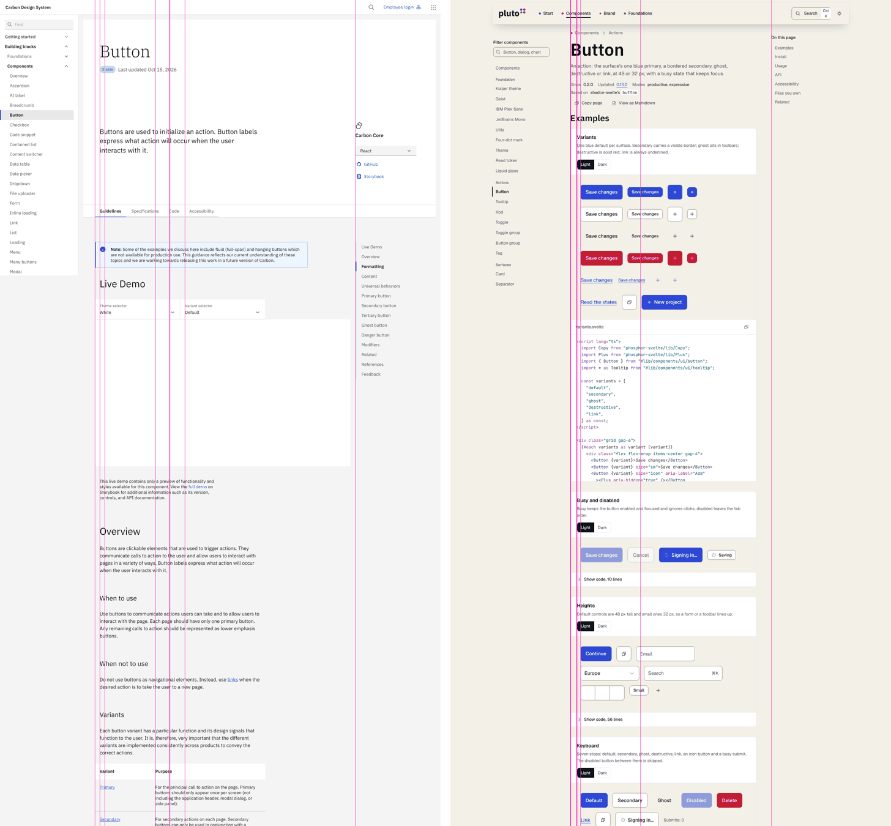
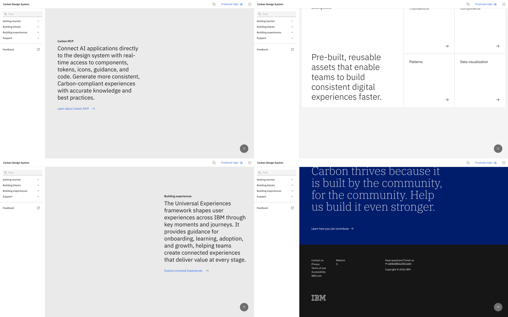
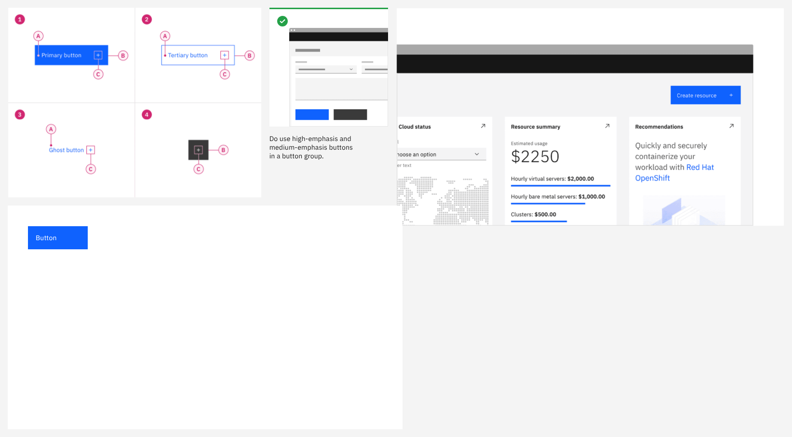
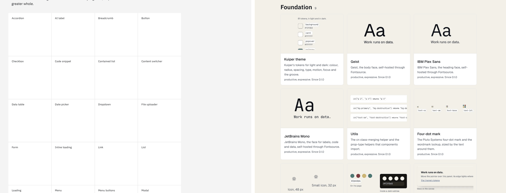

# Carbon as a visual product: what makes it look finished, and how to score it

- **Status:** complete
- **Date:** 2026-11-17
- **Author:** a researcher, one of five running at once. This slice is Carbon and the IBM Design Language. The owner looked at carbondesignsystem.com and called it "miles ahead of us in design".
- **Question:** What makes Carbon's site look polished, in terms we can measure? What visual-identity assets stand behind it? Which of its signals can become benchmark-scorecard criteria with 0–4 anchors? Where does Kuiper fall short, page for page?
- **What would answer it:** Carbon's live site, captured and measured at 1440 × 900 and 390 × 844, with its real fonts, figures and art. The IBM Design Language pages on ibm.com. Kuiper's built site, captured and measured in the same way. A proposed criterion for each signal, with anchors that two scorers can apply alike.
- **Builds on:** [`2026-11-15-prior-art-carbon.md`](./2026-11-15-prior-art-carbon.md), which read Carbon's source (tokens, the grid package, the type scale, motion tokens, the component-page tabs). [`2026-11-15-design-sites-enterprise.md`](./2026-11-15-design-sites-enterprise.md) §3.1, which read its pages for navigation and layout. This memo does not repeat either one. It reads Carbon as a picture.
- **What it blocks:** nothing. It feeds the scorecard's proposed visual-identity rows. The other four memos of this run feed them too.

## In short

- **The earlier finding does not hold.** [`2026-11-15-site-polish-synthesis.md`](./2026-11-15-site-polish-synthesis.md) said the reference sites "are not better designed screen for screen". Measured screen by screen, Carbon's differ from Kuiper's in three ways. Carbon draws its own pictures. Its type has a voice. Its edges line up.
- **Gap 1: Carbon draws, Kuiper does not.** Carbon's Button page carries 103 images, covering 30% of the page's area. They are anatomy figures, do/don't pairs and pictures of the button in a product. Every component has a drawn thumbnail in one style. The home page has line-art illustration and eight Lottie animations, all in IBM blues and greys. IBM keeps 1,564 pictograms and 2,758 icons of its own. Kuiper's site has no drawn art, no figures on component pages, and borrowed icons. Its own Imagery page says it has "none drawn yet".
- **Gap 2: Carbon's type has one voice, and Kuiper's has three.** Carbon uses one family (IBM Plex). It sets a light serif title (Plex Serif 300, or 200 on the home page) over a regular sans. Size makes the hierarchy, not weight. Kuiper mixes three unrelated families (Geist, IBM Plex Sans, JetBrains Mono). Every heading is weight 600. On Kuiper's Button page, half the characters are in the monospace face.
- **Gap 3: Carbon's edges line up, and Kuiper's nearly do.** On Carbon's Button page, 1% of text blocks sit 2–4 px off a stronger edge, and one left edge holds 66% of all blocks. On Kuiper's Button page the figure is 13%, spread over 22 edges. Carbon's figures snap to one, two or three columns of a 278 px module. Its surfaces are flat and square. Kuiper's are rounded and shadowed, with four shadow recipes on one page.
- **Kuiper leads in two places.** It has a dark site, and Carbon has none. Its examples are live, while Carbon's page has one live demo, with everything else drawn.
- **Neither site uses its own motion curves.** 12% of Carbon's transitions pair a token duration with a token curve. 4% of Kuiper's do: 89 of its 93 use Tailwind's default curve, not a Kuiper token.
- **Eleven criteria are proposed** (§8): six scripted, five judged. On them, Carbon scores 33 of 44 and Kuiper 16.

## How to read this memo

Every claim carries a label.

- **EXECUTED:** run in this research on 2026-11-17, on Linux, with Bun 1.4.4 and the repository's Playwright Chromium, at a device scale factor of 1. Sizes are computed styles read in the page. Pixel figures come from the screenshots. The scratch scripts are not committed.
- **READ:** seen on a page, in a screenshot or in a file, cited by path or URL.
- **INFERRED:** our reasoning.

**What was measured.** Carbon is measured live, as served on 2026-11-17. Kuiper is measured from `build/`, built 2026-11-16 at commit `b01e754` (its footer says so), served by `scripts/bench/serve.ts`.

**Limits.**

- The first pass ran before the coordinator opened `cdn.carbondesignsystem.com`, `1.www.s81c.com`, `react.carbondesignsystem.com` and `www.ibm.com`. In that pass, Carbon rendered without its figures. Every Carbon shot and number here comes from the second pass, with those hosts open.
- Two things still did not load. The Lottie player's WebAssembly file comes from `cdn.jsdelivr.net` and `unpkg.com`, which stay blocked, so the home page's eight animations are blank in the shots. Their files did load, and §2.5 reads them as data. The Colour page's intro video comes from Kaltura, also blocked.
- Analytics hosts (`www-api.ibm.com`) failed. They paint nothing.

**Terms of art.**

- **2x Grid:** IBM's layout grid. Its basic unit is an 8 px square, the *mini unit*. Columns are made by halving the space, and fixed boxes by doubling a size.
- **Pictogram:** a drawn symbol for an idea, at 48 px or more. It is not an icon, which is a small symbol for a control.
- **Greeking:** drawing text as grey bars, so a picture shows layout without words.
- **Lottie:** an animation stored as JSON and played in the browser.
- **Superfamily:** one typeface designed in several related styles: sans, serif and mono.
- **Chromatic pixel:** a pixel with HSV saturation over 0.25 and value over 0.2. Everything else counts as a neutral.
- **Near-miss edge:** a left text edge 2–4 px from a more-used edge. It reads as a mistake, not an indent.
- **Ink box:** the smallest rectangle around a picture's drawn pixels.
- **Logo-cover test:** one of IBM's design principles: "If you covered up our logo or name, would you identify an execution as being designed by IBM?" (READ, ibm.com/design/language/philosophy/principles).

## 1. What was captured

Shots are in [`2026-11-17-visual-carbon/`](./2026-11-17-visual-carbon/). There are 16 PNGs. Matched pairs are named `<page>-<site>-<width>.png`, and composites say which side is which.

| Page type | Carbon | Kuiper |
|---|---|---|
| Home | `/` | `/` |
| Components index | `/building-blocks/core/components/overview/components` | `/components/` |
| Button | `/building-blocks/core/components/button/guidelines` | `/components/button/` |
| A foundation | `/building-blocks/foundations/color/overview` (and Typography, 2x Grid, Pictograms) | `/foundations/colour/` (and Type, the Foundations landing) |

Each page was taken at 1440 × 900 light, 390 × 844 light, and 1440 × 900 with the dark preference (EXECUTED).

## 2. What makes Carbon look finished

### 2.1 The grid and the edges

- **One edge carries the page.** On Button, 319 of 486 text blocks start at x = 326 (66%). The four most-used edges hold 91% (EXECUTED). Its Type page reads 96%, and Colour 83%.
- **Near-misses are rare.** On Button, 1% of blocks sit 2–4 px off a stronger edge. Colour, Type, Components and Home read 0% (EXECUTED).
- **Figures snap to column spans.** The Button page's figures are 247, 525 or 804 px wide. That is one, two or three spans of a 278 px module: 247 px plus a 31 px gutter (EXECUTED, image boxes in the page). The second-most-used text edge, x = 604, sits one module from the first.
- **Aspect ratios come from a short list.** The ratios seen are 1:1 (247 × 247), 4:3 (525 × 394), 16:9 (804 × 452), and a few tall figures at 2:3 and 3:2 (EXECUTED). The 2x Grid page names "a core set of aspect ratios" (READ, carbondesignsystem.com 2x Grid overview).
- **The spacing sits on the mini unit.** 81–95% of the margins, paddings and gaps on Carbon's pages are multiples of 8 px (EXECUTED). Kuiper's sit on its own 4 px atom at 82–99% (EXECUTED), so this is not a gap.
- **The rules are written.** Padding is "always a fixed multiple of mini units: 16 pixels at all standard breakpoints". The rule says "Always place type against the padding", and "the margin around each grid box matches its padding, for a total gutter of 32 pixels" (READ, the same page).

### 2.2 Type

| | Carbon | Kuiper |
|---|---|---|
| Families carrying text | Plex Sans, Plex Serif, Plex Mono: one superfamily | Geist, IBM Plex Sans, JetBrains Mono: three makers |
| Monospace share of characters, Button page | 0.1% | 50% (4,482 of 8,925) |
| Monospace share, Colour page | 4% | 42% |
| Page title (h1) | Plex Serif **300**, 53.6 px; **200** at 94.6 px on home | Plex Sans **600**, 56 px leaf, 86.4 landing, 160 home |
| h2 / h3 / h4 | 32 / 21.9 / 16, weights 400 / 400 / 600 | 28 / 16 (Geist) on Button, 28 / 20 (Plex) on Colour, all 600 |
| Sizes carrying 95% of characters, Button | 2 (16, 14) | 2 (13.5, 16) |

All figures above are EXECUTED.

- **Contrast through size, at light weights.** IBM's type guidance shows "Scale with one weight" and "Contrast with one weight" as its ways to separate a title from a subtitle (READ, ibm.com/design/language/typography/type-basics). The site follows it. Its heading ladder steps 1.68×, 1.46× and 1.37× at weights 300–400.
- **Kuiper's ladder has a hole.** h3 on component pages is the body's 16 px, set in another face. The 2026-11-15 teardown found the same (READ, *enterprise* §2), and it remains (EXECUTED).
- **The serif is rare, and so it is memorable.** Plex Serif sets 5–10 characters per page, the title only. On the home page it also sets the large statements (EXECUTED). One cut, used once per page, is the site's signature (INFERRED).
- **Kuiper's three faces are a brand decision.** Geist, Plex Sans and JetBrains Mono come from the Pluto Systems design book (constitution §2.1). This memo reports the effect. It does not overrule the book. See question 2 in §7.

### 2.3 Colour

- **Neutral pages, blue accents.** On the Button, Colour and Components pages, chromatic pixels are under 1% of the full page, figures included (EXECUTED). The surfaces are white panels on Gray 10 (`#f4f4f4`), and the footer is Gray 100 (`#161616`). Two or three surface tones fill 98% of each page (EXECUTED).
- **Colour is spent in one place.** The home hero is 64% chromatic, and all of it is one hue family: Cyan 20 (`#bae6ff`) behind Blue 70 line art (EXECUTED).
- **The rule is written.** "Each experience should be dominated by the grays and the core colors of black, white, and the blue family". "The neutral gray family is dominant in our UI, making use of subtle shifts in value to help organize content into distinct zones" (READ, ibm.com/design/language/color).
- **Kuiper is not behind here.** It is under 1% chromatic on Button and Colour (EXECUTED). Its colour is spent on the home circles and the landing bands. It uses four hue families on purpose: the four doors. Its colour use is disciplined in its own way (INFERRED). No criterion below rewards fewer hues.

### 2.4 Page headers and the home page

- **One header for every leaf page.** It is a white panel 540–600 px tall. The title is top left, at the shared edge. The lede is pinned to the panel's bottom left. Facts (status, last updated, the framework picker, GitHub, Storybook) sit in a right column at x = 1161. The tab bar closes the panel (READ, `button-carbon-1440.png`, `colour-carbon-1440.png`). The rest is white space by design: the page header's markup has no image slot (EXECUTED, the page's HTML). On scroll, a condensed sticky title takes over (READ, the class `cxp--page-header__title-sticky`).
- **The cost.** The tall header pushes the first content to y ≈ 790. The scorecard already marks Carbon down for this (row 7, "The part first": 1). A polish criterion must not reward it back (INFERRED).
- **The home page tells one story, in sections.** It has a hero; three scroll-pinned stages, 2,700 px each, that hold a statement while an animation plays; and three "split stacks", each a large light statement beside a 2 × 2 grid of doors. It ends on a dark-blue band set in Plex Serif Light and a black footer with the 8-bar logo (READ, `home-carbon-sections.png`; EXECUTED, the DOM). The page is 11,207 px tall. Kuiper's home is 2,814 px (EXECUTED).

### 2.5 Illustration, pictograms, figures and imagery

- **How much there is.** These are images of 100 px or more, and their share of the page's area (EXECUTED):

  | Page | Images | Share of page area |
  |---|---|---|
  | Components index | 82 | 57% |
  | Home | 25 | 41% |
  | Button | 103 | 30% |
  | Colour | 38 | 28% |
  | 2x Grid | 27 | 23% |
  | Type | 16 | 9% |

  Kuiper's Button, Colour, Type and Home pages carry none. Its Components index carries 79 thumbnails (EXECUTED).
- **Component figures follow one recipe.** An anatomy figure is a 2 × 2 grid of panels on 1 px dividers. Its numbered circles and lettered callouts are in magenta, a colour used nowhere else. A do/don't pair sits on two 1:1 squares, each with a green or red top rule and a check or cross. Product pictures are 16:9 crops of a real IBM product screen (READ, `button-carbon-figures.png`).
- **Foundations are drawn twice.** The Colour page draws its layering model in light and in dark, side by side, and repeats its do/don't pairs in both themes (READ, the full Colour capture). The site has no dark mode, but its figures do.
- **Thumbnails are one drawing style.** 40 of the 41 component thumbnails share one 320 × 320 artboard. None holds a text element: words are greeked. Each uses a median of 4 colours (EXECUTED, the SVG files). Within each tile, the drawing fills a median 15% of the drawing area, and 25% at the 90th percentile. None touches the tile's edge (EXECUTED).
- **The art keeps to the palette, nearly.** In the thumbnails, 55% of colour uses are exact IBM palette values. 91% are within 8 RGB steps of one, and 100% within 16. The near-misses are export drift, such as `#f3f3f3` for `#f4f4f4` (EXECUTED). The eight home Lottie files use 2 to 7 colours each, all IBM palette values but one grey (`#939393`). Each runs 1.0–5.0 s at 60 fps (EXECUTED, the JSON).
- **Pictograms have a library and rules.** There are 1,564 pictograms in 44 categories, on 208 px square tiles with 1 px gridlines (EXECUTED, `pictograms-carbon-tiles.png`). They are drawn on a 32 px master grid, every stroke 0.72 px (1.44 px in the expressive set), 48 px at the smallest. They are never used as UI icons (READ, ibm.com/design/language/iconography/pictograms/design; carbondesignsystem.com Pictograms guidelines).
- **Illustration has styles and principles.** The styles are line, flat, isometric and "hybrid UI". The principles are "engineered, clear, nimble, diverse and delightful". Hybrid UI is "the offspring of user interface design and conceptual illustration": product UI, greeked, on the 2x Grid (READ, ibm.com/design/language/illustration/overview and …/hybrid-ui-style/design). Carbon's home hero is this style (READ, `home-carbon-1440.png`).
- **Photography is documentary.** IBM's photography is "reportage", "editorial, like documentary filmmaking" (READ, ibm.com/design/language/photography/overview). Carbon's site shows almost none. Its pictures are drawn (READ, the shots).

### 2.6 Icons

- **One owned set, sized to the type.** Carbon's library holds 2,758 icons in 25 categories (EXECUTED). Icons sit on 16, 20, 24 and 32 px artboards. "16px and 20px icons are optimized to feel balanced when paired with 14px and 16px IBM Plex". Icons take the colour of their text (READ, carbondesignsystem.com Icons guidelines). On the Button page, icons are 20 px (71), 24 px (52) and 16 px (15) (EXECUTED).
- **Kuiper borrows its icons.** It uses Phosphor, at 16 px on 34 of the 37 icons on Button, and 23 px on the other three (EXECUTED; READ, `phosphor-svelte` imports in `src/lib`). Using one set at one size looks consistent. It is not an owned asset (INFERRED).

### 2.7 Tiles, cards and tabs

- **Carbon's tiles are flat.** Square tiles, 1 px gridlines, the label top left at the padding, the drawing centred. On a page there are 0–2 radius values, on 1–5 elements, and 1–2 shadow recipes, one of them the header's (EXECUTED).
- **Kuiper's cards are soft.** 8 px radius on 96–416 elements per page, plus pills and circles. Up to 4 shadow recipes: 175 shadowed elements on Colour, and a shadow on the floating bar (EXECUTED). Its thumbnails are live renders in a 292 × 183 frame. Their drawn area fills a median 49% of the frame (99% at the 90th percentile), and 12 of 79 touch its edge (EXECUTED). Utils' text runs off its card (READ, the shot).
- **Tabs.** Carbon's component page has four tabs (Guidelines, Specifications, Code, Accessibility). Its foundation pages have three or four (Overview, Guidelines, Tokens, Code) (READ). The earlier memo already advised against tabs for Kuiper (READ, *Carbon* §7). What gives Carbon its finish is the tab bar's look: a flat, full-width band that closes the header. The tabs themselves add nothing to it (INFERRED).

### 2.8 Specimens and diagrams

- **Type specimens.** The Type page sets "IBM Plex Sans / Serif / Mono" in the faces themselves, in a white panel. The scale is a ladder of 23 live steps, "Plex 12" to "Plex 92", each at its size (READ, `type-carbon-left-kuiper-right.png`, left). Kuiper's Type page now has specimens too: each family's sample, the text scale and a drawn display-step figure (READ, the same shot, right).
- **Diagrams.** Carbon draws its concepts: the layering model, the colour anatomy strip, grid behaviours and the anatomy callouts. IBM's technical-diagram rules fix the node grid (8 px), outline (1 px), radius (8 px) and icon sizes (24 px in nodes, 16 px in labels) (READ, ibm.com/design/language/infographics/technical-diagrams/design). Kuiper's figures are drawn in code, as tables and the display-step bars. Its component pages have none (EXECUTED, image count 0).

### 2.9 Motion

- Over Carbon's four matched pages there are 2,238 transition declarations. 93% use a token duration, mostly 110 ms. Only 12% also use a token curve: 1,716 are `110ms ease` (EXECUTED).
- Over Kuiper's four there are 93. 100% use a token duration (200 ms, `micro`). 4% use a token curve. 89 are `200ms cubic-bezier(0.4, 0, 0.2, 1)`, Tailwind's default (EXECUTED). `src/app.css:325` sets `--default-transition-duration` to the token but leaves the default timing function unset (READ).
- Carbon's home animations are its one motion moment. Under reduced motion, 74–77% of the pixels on three of the stages differ from the full-motion capture, so the site does respond to the setting (EXECUTED). Whether it shows a still in place of each animation could not be seen, because the player did not load (see Limits).

### 2.10 Dark parity

- Carbon's site has no dark mode. With a dark preference, its body stays `#f4f4f4` (EXECUTED, `button-dark-carbon-left-kuiper-right.png`). Its figures, though, are drawn in both themes (§2.5).
- Kuiper's site turns fully dark (`#16140f`). Every example frame has its own scheme switch, and the index thumbnails swap (EXECUTED).

### 2.11 Density and whitespace

- Carbon's leaf pages are long and airy. Button is 47,514 px tall and Colour 19,617, against Kuiper's 7,883 and 15,768 (EXECUTED). Body text is 16 px on a measure of about 62 characters (READ, *enterprise* §2).
- On a phone, Carbon keeps the same panel structure. The header shrinks, and the tabs scroll sideways (READ, `phones-390-carbon-kuiper-pairs.png`).
- Kuiper is denser: 13.5 px is its most-used size (EXECUTED), which the teardowns flagged before.

## 3. The assets behind Carbon's look

All READ on ibm.com/design/language and carbondesignsystem.com, 2026-11-17.

| Asset | What it is | In code? |
|---|---|---|
| Design principles | "Carefully considered", "Uniquely unified", "Expertly executed"; the logo-cover test | Writing |
| 2x Grid | 8 px mini unit; 4, 8 or 16 columns; 16 px padding; 32 px gutters; aspect ratios | Yes, `@carbon/grid` |
| IBM Plex | Sans, Serif, Mono and Condensed; eight weights; open source | Yes, font files |
| Colour palette | Ten-step families, grey-led, "blue at the core" | Yes, tokens |
| UI icons | 2,758; 16, 20, 24 and 32 px artboards; one colour each | Yes, SVG packages |
| Pictograms | 1,564; 32 px grid; 0.72 px stroke; productive and expressive sets | Yes, SVG packages |
| Illustration | Line, flat, isometric and hybrid-UI styles, with principles | Guidance and kits; the site's art is SVG and Lottie |
| Photography | Reportage, portraiture, guidance on choosing | Guidance only |
| Technical diagrams | Node, connector and label rules on the 8 px grid | Guidance |
| Figma libraries | Components, colour, icons, pictograms, a "Hybrid UI Kit" (an IBM login, w3id, is required) | Design tool |

INFERRED: IBM's polish is less a page template than an asset supply. A team that drew one anatomy figure, one thumbnail and one pictogram did so to rules that make the next one match. Kuiper has the rules for some of these: its brand Imagery page names four kinds of picture. It has no supply.

## 4. Kuiper beside Carbon, page by page

All READ from the matched shots unless marked.

**Home** (`home-carbon-1440.png`, `home-kuiper-1440.png`).

- Carbon spends its first screen on one light statement and a drawn hero in one hue.
- Kuiper spends its first screen on a 160 px, weight-600 title and four flat circles in four hues. The circles are brand colour, not a picture of anything.
- Below the fold, Carbon tells three stories, each with art. Kuiper gives a command and its files, then four lists of links.

**Components index** (`components-carbon-1440.png`, `components-kuiper-1440.png`, the grid composite).

- Kuiper's red band and large count make a bolder first screen than Carbon's white header.
- The cards are the gap. Carbon's are 41 drawn tiles, at one scale, with air around each. Kuiper's are 79 live renders at varying scale, 12 touching their edge (EXECUTED).

**Button** (`button-carbon-1440.png`, `button-kuiper-1440.png`, the figures and edges composites).

- Kuiper shows the part sooner (row 7) and live in both schemes. Carbon shows one live button in an 819 × 464 frame, then pictures.
- Kuiper has no anatomy figure, no do/don't pictures and no picture of the button in a product.
- Kuiper's frame header text sits at x = 409, its stage content at 413 and 416, and the page text at 392. These are three near-misses (EXECUTED).

**Foundation** (`colour-carbon-1440.png`, `colour-kuiper-1440.png`, `type-carbon-left-kuiper-right.png`).

- Kuiper's Colour page is a table of roles with swatches and measured contrast. It is sound, but it shows no picture of how the colours combine.
- Carbon's opens with a palette strip and the layering model drawn in light and dark.
- On type, the two now roughly match: both show live specimens.

**Phone** (`phones-390-carbon-kuiper-pairs.png`). Both hold up. Carbon's light serif titles still carry the voice at 390 px. Kuiper's bold titles read as generic (INFERRED).

**Dark** (`button-dark-carbon-left-kuiper-right.png`). Kuiper wins outright.

## 5. Where Carbon's practice conflicts with Kuiper's rules

- **"Not a marketing site"** (constitution §3). The home page's scroll-pinned story, with an animation per stage, is close to marketing. What can transfer is the structure: one message per section, a door, and a picture. The spectacle should not transfer (INFERRED).
- **"Not a design-tool kit"** (§3). IBM's illustration and pictogram supply lives partly in Figma kits behind an IBM login. Kuiper would draw its own as SVG in the repository, from tokens. Pictograms and thumbnails are plain files, so this fits "we design in code" (INFERRED).
- **"Tokens are the one source"** (§4.3). Only 55% of Carbon's thumbnail colours are exact palette values. Kuiper's art would have to be stricter: colours read from tokens at build time, or checked by a test (INFERRED).
- **Live examples** (`015` decision 13). Carbon pictures what Kuiper runs live. Figures should add to the live examples, never replace them (INFERRED).
- **The part first** (scorecard row 7). Carbon's 600 px header delays the part. Kuiper's header can carry the same order and voice without the height (INFERRED).
- **Prior art is studied, never copied.** Nothing here should reuse IBM's art, pictograms or Plex Serif titling as a look. The criteria below measure properties (one voice, owned art, edge discipline). They do not measure resemblance to IBM.

## 6. The three biggest visual gaps

1. **No drawn visual language.** There are no figures, thumbnails, pictograms or illustration, and no style that would make them match. This explains most of "miles ahead". Carbon's pages are 9–57% picture by area; Kuiper's are 0%, except the index.
2. **No single type voice.** There are three families, all headings are weight 600, and the h3 step is missing. Monospace carries half of the component page. Carbon gets its voice from one superfamily and a light serif title.
3. **Loose geometry.** Near-miss edges cover 13% of the blocks on Button. There is no column module for figures. Surfaces are soft and shadowed where Carbon's are flat. Each fault is small, and together they make the page look unfinished.

## 7. Questions for the owner

1. **Should Kuiper draw its own pictures?**
   - (a) **Recommended:** a small, rule-bound set, drawn as SVG from tokens and committed. It would be one thumbnail per component in one style, an anatomy figure per component, and a short pictogram set for the docs. A rule page would fix the grid, stroke and palette, with a test that checks each.
   - (b) Thumbnails only.
   - (c) None, with live renders staying the only pictures.
2. **Should the site's type voice be reviewed?** The faces come from the design book.
   - (a) **Recommended:** keep the faces, but give headings one face and a light-to-regular ladder with a real h3 step. Fold code to a toggle by default, so that monospace stops carrying half the page.
   - (b) Reopen the face choice in the design book.
   - (c) No change.
3. **Should the eleven criteria below join the scorecard** as a visual-identity section, scored outside the headline total as row 15 was?
   - (a) **Recommended:** yes, after the other four memos of this run are merged and the overlaps are removed.
   - (b) Yes, as they stand.
   - (c) No.

## 8. Proposed scorecard criteria

Scripted criteria run on four matched pages: Home, Components index, Button, and one foundation (Colour). Each runs at 1440 × 900, light, device scale factor 1, unless the criterion says otherwise. Judged criteria are scored by two people, from logo-masked shots of the same four pages, against the written anchors. Where they differ, they take the lower score and record why.

| # | Criterion | Kind | How to measure | Anchors (0–4) | Carbon | Kuiper |
|---|---|---|---|---|---|---|
| V1 | **Owned imagery** | Judged checklist | Count five: (a) one icon family, sized to the type scale, with written sizing rules; (b) a pictogram or spot-illustration set of the system's own; (c) a written illustration style, with assets used on the site; (d) a figure (anatomy or do/don't) on every component page; (e) every picture on the site in one style. | 0–1 → 0; 2 → 1; 3 → 2; 4 → 3; 5 → 4 | 4 | 0 (at most (a), which lacks written rules) |
| V2 | **Art palette from tokens** | Scripted | Parse every SVG and Lottie file the four pages load. Score the share of colour uses within 8 RGB steps (largest channel) of a colour token. | No drawn art → 0; < 50% → 1; ≥ 50% → 2; ≥ 80% → 3; ≥ 95% → 4 | 3 (91%) | 0 (no art) |
| V3 | **Index picture framing** | Scripted | On the components index, screenshot each item's picture, trimmed of labels and borders. Check four: (a) every item has one; (b) one artboard size; (c) no ink box touches the edge; (d) the ink box fills ≤ 60% of the frame at the 90th percentile. | Count of (a)–(d) | 4 | 2 (a, b) |
| V4 | **Type voice** | Scripted | From computed styles, check four: (a) all text faces from one superfamily plus at most one mono; (b) ≤ 2 sizes carry 90% of prose characters, code excluded; (c) each heading level ≥ 1.2× the next and the body; (d) each heading level has the same face, size and weight on every leaf template. | Count of (a)–(d) | 4 | 1 (b) |
| V5 | **Edge discipline** | Scripted | For text blocks in `main`, take the left text edge (box plus padding). Score the share 2–4 px from a more-used edge. Use the median over the four pages. | ≤ 1% → 4; ≤ 3% → 3; ≤ 6% → 2; ≤ 12% → 1; else 0 | 4 (0%) | 2 (5.3%: 6.8, 0, 12.7, 3.8) |
| V6 | **Diagrams and specimens** | Judged | Look at Button and two foundations. | 0: tables only. 1: live samples inside tables. 2: specimens at true size for every step (type, swatches ≥ 48 px). 3: also purpose-drawn diagrams (anatomy with callouts, a layering or grid figure) in one diagram style, on column spans. 4: also do/don't pairs in one frame, and diagrams in every scheme. | 4 | 2 |
| V7 | **Page header system** | Judged | Look at Button, Colour and the Components index. | 0: title only. 1: title and lede, alike on every template. 2: also facts (status or updated) on every leaf template. 3: also fixed positions for title, lede and facts on the grid, and a condensed sticky form. 4: also the first example or picture starts within 450 px at 1440. | 3 | 1 |
| V8 | **Home structure** | Judged | Look at the home page, top to bottom, at 1440 and 390. | 0: a list of links. 1: a hero and links. 2: also sections with one message and one way in each. 3: also a picture in the house style in each section. 4: also one motion moment that becomes a still under reduced motion, with no section longer than one screen of text. | 3 | 2 |
| V9 | **Motion from tokens** | Scripted | Over the four pages, collect every transition declaration (duration and curve). Score the share where both equal a motion token. | ≥ 95% → 4; ≥ 75% → 3; ≥ 50% → 2; ≥ 25% → 1; else 0 | 0 (12%) | 0 (4%) |
| V10 | **Dark parity** | Scripted | Load each page with the dark preference. Check four: (a) the body ground changes; (b) examples render dark; (c) pictures and thumbnails swap; (d) the automated contrast check passes in dark. | 0: none. Otherwise the count of (a)–(d) | 0 | 4 |
| V11 | **Logo-cover test** | Judged | Make 1440 shots of the four pages with the logo and name masked. Mix them with two stock documentation templates. Each scorer names the system. | 0: indistinguishable from stock. 1: one owned signal (a colour or a ground). 2: several owned signals, but stock chrome (cards, shadows, type) dominates leaf pages. 3: owned signals on every page, leaf pages included. 4: both scorers name it from any page at thumbnail size. | 4 | 2 |
| | **Total, of 44** | | | | **33** | **16** |

**Notes on the scores.**

- Kuiper's V1 (a) fails only for want of written sizing rules. If the brand pages already hold them, V1 still reads 0: one of five maps to 0.
- V9 ties at 0. For Kuiper the fix is one line: set `--default-transition-timing-function` to a Kuiper curve. That would move V9 to about 4 (INFERRED).
- V2 and V3 measure the quality of drawn art. V1 measures whether art exists. A Kuiper that draws thumbnails would move V1, V2 and V3 together. Merging V2 into V1 would avoid counting the same work twice, if the other memos prefer that.
- No criterion rewards fewer hues, square corners or a serif. Those are Carbon's choices. The rows measure consistency, ownership and alignment.
