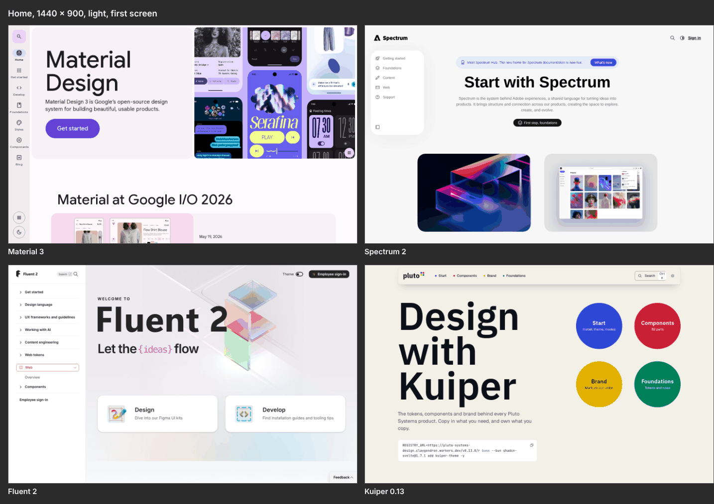
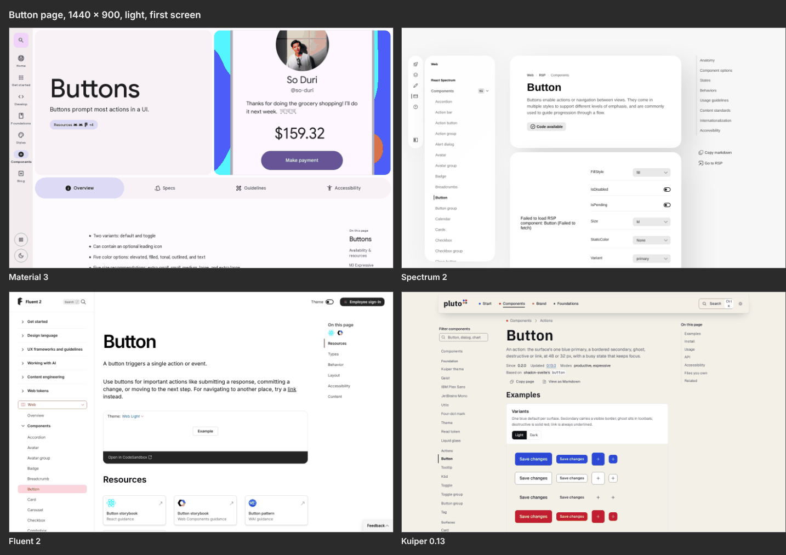
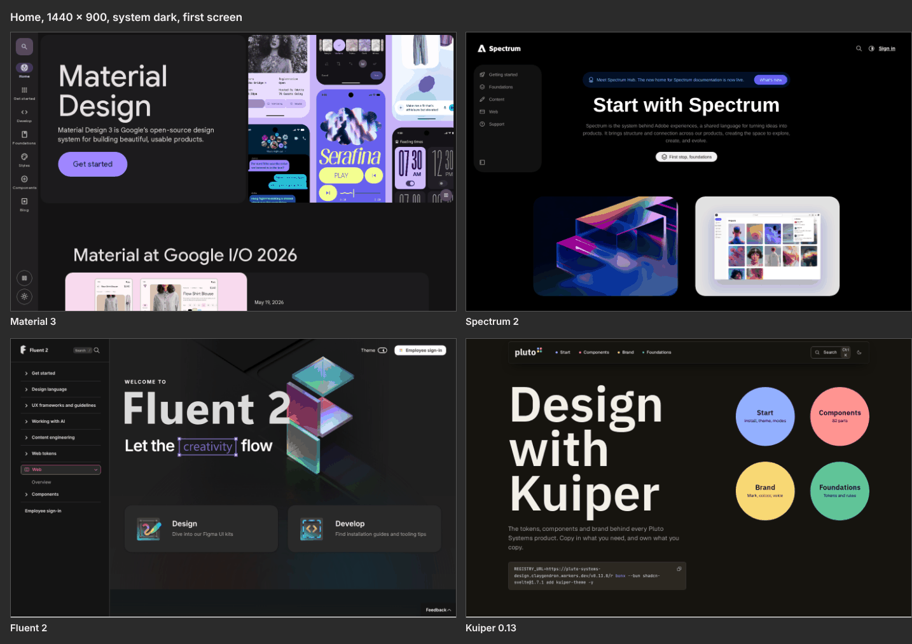

# The brand-expressive systems: Material 3, Spectrum 2 and Fluent 2 as visual products

- **Status:** complete
- **Date:** 2026-11-17
- **Author:** a researcher, one of five on the visual-identity run. The owner looked at carbondesignsystem.com, said it is "miles ahead of us in design", and asked why we are not making progress.
- **Question:** What makes the sites of the three most brand-expressive systems (Material 3, Spectrum 2, Fluent 2) read as *designed*? What do they share, where do they differ, how does Kuiper compare page for page, and which of those signals can become scorecard criteria with 0–4 anchors?
- **What would answer it:** matched screenshots of each site's home, Button page and one foundation page, beside Kuiper's, at 1440 × 900 and 390 × 844, light and system dark; computed styles and pixel counts from the same loads; the teams' own accounts of how the sites were made.
- **Builds on:** [`2026-11-15-design-sites-enterprise.md`](./2026-11-15-design-sites-enterprise.md), which measured Material's and Spectrum's layout, navigation and type sizes. This memo does not repeat those. It looks at pictures, colour, shape, motion and finish. The sibling memo [`2026-11-17-visual-practice.md`](./2026-11-17-visual-practice.md) covers who does this work and how; its proposed rows 16–20 sit beside the criteria here (§9).
- **What it blocks:** nothing. It proposes scorecard criteria (§10) for the design lead to rank, and three owner questions (§9).

## In short

- **The 2026-11-15 finding does not hold for these three.** Screen for screen, all three are better *finished* than Kuiper. The difference is not colour. Kuiper's home is the most colourful page measured here (EXECUTED, §2b). The difference is pictures, and how carefully every picture, surface and movement is drawn the same way.
- **Five craft moves are shared** (§4):
  1. **A figure system.** Every figure sits on one ground, at one radius, with one caption style. Material and Fluent put 18 to 26 figures on their Button pages per 1,000 words. Kuiper puts 4, and all 4 are live examples.
  2. **Art in the page header**, built from the system's own palette, shapes or materials. It fills 16 to 33% of a foundation page's first screen. Kuiper's fills 0%.
  3. **A ladder of surfaces and corners.** Five to seven radii, with containers rounder than the controls inside them. Kuiper uses one radius, 8 px, for both.
  4. **Many tones, few hues.** Material's home holds 44 distinct colours; Kuiper's holds 17, at full strength.
  5. **Motion on one named curve.** All 53 transitions on Material's Button page use one easing. All 70 on Kuiper's use Tailwind's default, not Kuiper's own `--ease-standard` token.
- **Where they differ** (§5). Material is expressive everywhere: commissioned art, shape-morphing motion, a page that re-colours to its pictures. Fluent is restrained in its component pages and lavish only in its headers. Spectrum's chrome (layered white cards, frosted art) is its identity; its component pages carry almost no pictures.
- **Kuiper leads on two things** (§6). Its examples redraw in either scheme, while Material's and Fluent's figures stay as light panels in a dark page. And its four-colour device is applied as consistently as any reference's.
- **Kuiper's three biggest visual gaps:** no figure system; bare page headers; and an unfinished surface (one radius, flat full-strength colour, motion off its own tokens).
- **Our rules shape the remedy** (§8). The design book bans decorative gradients, looping motion and colour as decoration. So Fluent's glass renders and Material's looping hero are out. Figures drawn in code from Kuiper's own parts and tokens are in. Kuiper's own Imagery page already names four kinds of picture, and two of them have "none drawn yet".
- **Nine criteria are proposed** (§10), five scripted and four judged. On them Material scores 34 of 36, Fluent 24, Spectrum 23 and Kuiper 13. One of Kuiper's points (motion on tokens) is a one-line fix.

## How to read this memo

Every claim carries a label.

- **EXECUTED:** run and seen in this research, on 2026-11-17, on Linux, with Bun 1.4.4 driving the repository's pinned Playwright 1.64.1 Chromium, headless, `deviceScaleFactor` 1. Reduced motion was **off**, so that motion could be observed. Kuiper was the built site in `build/`, served by `scripts/bench/serve.ts`. The scripts lived in the session scratchpad and are described in §2 so they can be rebuilt.
- **READ:** a source says so. Material's blog posts were rendered from m3.material.io and read in full. Fluent's foundation pages were read in full from fluent2.microsoft.design. Articles on other hosts (microsoft.design, adobe.design, The Verge) could not be fetched; for those, only a search engine's excerpt was read, and the claim says so.
- **INFERRED:** our reasoning.

**Terms.**

- **Figure:** a picture on a docs page that explains something: a specimen drawn as an image, an anatomy diagram, a do or don't example. A live example is not a figure here; row 7 and row 9 of the scorecard count those.
- **Anatomy diagram:** a figure of one component with numbered callouts pointing to its parts, and a legend.
- **Do/don't pair:** two figures side by side, one right and one wrong, each labelled.
- **Figure frame:** the ground, corner radius and caption style a figure sits in.
- **Header art:** a picture in a page's header, beside or under the title.
- **Surface ladder:** the set of grounds a page stacks (page, card, inset), each a step lighter, darker or higher.
- **Tonal range:** how many distinct colours a screen holds, counted after rounding each channel to 16 levels.
- **Colourfulness:** Hasler and Süsstrunk's single-number measure of how vivid an image is. It rises with saturated colour.
- **Signature device:** a recurring visual element, not the logo, that marks a page as the system's own.
- **Expressive / restrained:** how far a site goes beyond what reading requires: art, motion, colour for its own sake.

## 1. What was captured

Shots are in [`2026-11-17-visual-expressive/`](./2026-11-17-visual-expressive/). Each is a labelled side-by-side of the four sites, in the order Material, Spectrum, Fluent, Kuiper. They were cut to 256 colours, as earlier memos did.

| File | What it shows |
|---|---|
| `home-1440-light.png`, `home-1440-dark.png`, `home-390-light.png` | Home, first screen |
| `button-1440-light.png`, `button-1440-dark.png`, `button-390-light.png` | Button page, first screen |
| `button-full-1440-light.png` | Button page, whole (cut at 9,000 px): how often figures appear |
| `colour-1440-light.png`, `colour-1440-dark.png` | A foundation leaf (Colour): the page header pattern |
| `figures-anatomy-dodont.png` | Crops: Material's do/don't and anatomy, Fluent's type figures and do/don't |
| `figures-dark-1440.png` | Crops: the same figures in the system dark scheme, beside Kuiper's examples |
| `index-and-cards-1440-light.png` | Cards and tiles: Material's and Kuiper's component index; Spectrum's and Fluent's home cards |

Pages used (EXECUTED): `m3.material.io/`, `/components/buttons/overview`, `/specs`, `/guidelines`, `/accessibility`, `/styles/color/overview`, `/components`; `spectrum.adobe.com/`, `/web/rsp/components/button`, `/foundations/color/colors`; `fluent2.microsoft.design/`, `/components/web/react/core/button/usage`, `/color/`, `/components/web/react`; Kuiper `/`, `/components/button/`, `/foundations/colour/`, `/components/`, `/brand/`.

**What the network allowed, and what that changes** (EXECUTED):

- **Fluent's assets** live on `fluent2websitecdn.azureedge.net`, which is blocked. The same files are served from `fluent2.microsoft.design/cdn/`, so requests were rerouted there. Without that, the site renders unstyled.
- **Fonts.** Spectrum's Adobe Clean comes from `use.typekit.net`, and Fluent's Segoe UI from `c.s-microsoft.com`. Both are blocked. **Spectrum and Fluent shots show fallback faces.** Their computed font stacks are reported as declared. Material's Google Sans loaded.
- **Spectrum's live playground** loads React Spectrum from `esm.sh`, which is blocked. Its stage shows "Failed to load RSP component". The playground is a live example, not a figure, so no figure count changes.
- Analytics hosts were blocked on all three. Nothing visible depends on them.

## 2. How the numbers were made

All EXECUTED, one run per page, at 1440 × 900 unless stated. A page was loaded, sampled for running animations at 0.3, 1 and 2.5 s, left to settle on network idle, had consent banners hidden (never accepted), and was screenshotted 2.5 s later.

- **Type, radii, shadows, transitions:** computed styles over every visible element. Radii and shadows are counted as distinct values. Transitions count elements with a non-zero duration, and tally their timing functions.
- **First-screen art:** the area of `img`, `video`, `canvas`, `picture` and large `svg` or `background-image` elements inside the first screen, over the screen's area. A background that covers the whole viewport is left out (Spectrum paints its page ground as an image).
- **Pixels:** on the raw first-screen shots, before the 256-colour cut. *Colourfulness* (Hasler and Süsstrunk); *tonal range* (colours, each channel rounded to 16 levels, that cover at least 0.1% of the screen); *hue spread* (of 12 hue sectors of 30°, how many hold at least 1% of the saturated pixels).
- **Figures:** on each Button page tab, media of 96 × 64 px or more inside `main`, plus Kuiper's live stages, over the words in `main`. Then the window was grown to the page's full height, and the pixel 6 px inside each figure's top-left corner was read. That is the figure's ground. *Ground share* is the share of figures on the most common ground.
- **First-screen text:** characters of text inside the first screen.

## 2b. Measured side by side

First screen, 1440, light, unless stated (EXECUTED).

| | Material 3 | Spectrum 2 | Fluent 2 | Kuiper 0.13 |
|---|---|---|---|---|
| Display face (declared) | Google Sans 475 | Adobe Clean Spectrum VF 500–600 | Segoe UI 600, tracking −4% | IBM Plex Sans 600, tracking 0 |
| Reading face | Google Sans Text | Adobe Clean Spectrum VF | Segoe UI | Geist |
| Home title | 96 px | 64 px | 40 px line under a drawn "Fluent 2" | 160 px |
| Art in first screen: home / Button / Colour | 33% / 28% / 28% | 23% / 0% / 16% | most / 5% / 33% | 0% / 0% / 0% |
| Colourfulness, home | 44 | 36 | 15 | **53** |
| Tonal range, home | **44** | 35 | 21 | 17 |
| Hue sectors, home | 6 | 8 | **10** | 4 |
| Distinct radii, Button page | 7 (4–40 px) | 5 (3–32 px) | 8 (2–22 px) | 2 (8 px and full) plus circles |
| Distinct shadows, Button page | 0 (tonal surfaces) | 2 | 4 | 4 |
| Transitions, Button page: count, curves | 50, **1 curve (100%)** | 14, 5 curves | 106, 8 curves (79% CSS `ease`) | 70, 1 curve: Tailwind's default |
| Running animations at 0.3 / 1 / 2.5 s, home | 0 / 18 / 4 | 0 / 0 / 0 | 22 / 22 / 22 (a loop) | 8 / 0 / 0 |
| Figures per 1,000 words, Button | 12–26 by tab | 0 | 18 | 4 (all live) |
| Figure ground share | lavender family, ~90% | none | **100%** | 100% (live stages) |
| Characters in first screen, Button | 587 | 599 | 683 | **862** |
| Dark: page ground follows the system | yes | yes | yes | yes |
| Dark: figures follow | no, light panels | (few figures) | no, light panels | **yes, redrawn** |

## 3. Site by site

### 3.1 Material 3

- **Home and hero.** A title card in a tinted container, beside a mosaic of phone screens shown as a looping video (EXECUTED). The rail holds a pause control for it. Below, news cards in pairs and triples, each with a picture.
- **Imagery.** Three kinds. Real product screens. Commissioned abstract art: "four distinct styles… (internally named Ambient, Handmade, Modern Folk, and Sci-Fi)" made by the agency Oddfellows (READ, [S1]). And diagram figures. The four styles clashed at first. "The solve was with color unification and simplification", by moving all of them onto Material's palettes (READ, [S1]). Header art keeps "lighter pastel areas for the legibility of black type" (READ, [S1]).
- **Colour.** Content-based dynamic colour. "Material.io's UI transforms to reflect" the colour of each component's art (READ, [S2]). Every surface is a tint of the page's theme hue. No shadows on the Button page; depth comes from tonal containers (EXECUTED: 0 shadows, 9 backgrounds).
- **Type.** One superfamily: Google Sans for display at weight 475, Google Sans Text for reading, Google Symbols for icons. The variable *grade* axis marks hover state, so labels do not change width (READ, [S2]).
- **Shape.** A corner ladder from 4 to 48 px. Tabs and buttons are pills. Bullets are small "cookie" shapes, "randomly rotat[ed]" (READ, [S2]; EXECUTED, seen on the Button overview).
- **Motion.** One easing, `cubic-bezier(0.2, 0, 0, 1)`, on every transition measured (EXECUTED: 101 of 102 on home, 53 of 53 on Button). Durations 200 and 300 ms. Top-level pages slide vertically; tabs slide sideways (READ, [S2]). Icons gain weight on hover and fill when selected (READ, [S2]).
- **Component pages.** Four tabs. Every figure sits on a lavender panel baked into the image (EXECUTED: corner grounds `#e0e0f8`, `#f8f0f8`, `#f0f0f8`). Anatomy is the part on a faint dot grid, with numbered circles and a legend (`figures-anatomy-dodont.png`). Do/don't figures carry a full-width bar: green "Do", red "Don't", yellow "Caution", each with an icon (EXECUTED). In 2022 the team had chosen blue, not green, for "Do", to avoid red and green (READ, [S2]); the live site has since gone back to green.
- **Page header.** Title card left, art card right, the same on home, component and foundation pages (`colour-1440-light.png`).
- **Cards.** 16–24 px radius, tinted, a picture on top. The component index shows each component drawn in its category's colour (`index-and-cards-1440-light.png`).
- **Dark.** The page follows the system. Header art and figures do not change (EXECUTED: the same image URLs in both schemes; `figures-dark-1440.png`). The 2022 redesign said "header images across the site… respond to dark and light mode" (READ, [S2]); that is no longer true of the pages measured.

### 3.2 Spectrum 2

- **Home and hero.** A centred title, a pill banner, and two large picture cards: a rendered glass abstract and a product screenshot (EXECUTED).
- **Imagery.** Rendered frosted-glass abstracts head the home and foundation pages (`colour-1440-light.png`). Spectrum 2 came with an "updated illustration system" by Adobe's Brand Design team, described as "a versatile toolkit of geometric shapes" (READ, search excerpts only, [S5]).
- **Chrome as identity.** White cards with 32 px corners and wide, soft shadows float on a `#f7f7f7` ground: the icon rail, the tree, the header, the content (EXECUTED). This layered paper is the signature. It came from Adobe Express's "lighter, bolder, and rounder" theme (READ, excerpt, [S5]).
- **Colour.** Almost none in the chrome. Colour lives in the pictures (EXECUTED: Button page colourfulness 0, home 36).
- **Type.** One family, Adobe Clean Spectrum VF (declared; it did not load here).
- **Motion.** Few transitions, on several curves (EXECUTED). Page changes use the browser's view transitions: the page script listens for `pagereveal` (READ, the home page's HTML).
- **Component pages.** Playground, then Anatomy as a text tree (`button` > `label`), then a props table, a states table and prose (EXECUTED: 0 figures over 2,173 words). The figures live on foundation pages, not here.
- **Dark.** The page ground is swapped for a dark image (READ: `<meta name="dark-bg">`; EXECUTED). Art is chosen to read on both. A white "Principles" card stays white on the dark Colour page (`colour-1440-dark.png`).

### 3.3 Fluent 2

- **Home and hero.** "Fluent 2" as a large drawn title beside a glass prism render, "Let the {ideas} flow" with the bracketed word cycling, then two white cards with 3D icon tiles on a pale gradient (EXECUTED).
- **Imagery.** 3D renders of glass, light and coloured tiles. Microsoft's 2024 illustration style uses "Fluent's Elevation system" for "camera angles and depth" (READ, excerpt, [S6]). The Colour page opens on a glass dish over coloured tiles (`colour-1440-light.png`).
- **Colour.** Restrained in the chrome: grey, white, one brand red in the navigation. Colour lives in the renders (EXECUTED: Button colourfulness 7).
- **Type.** Segoe UI throughout, declared. The Button title is 68 px with −2.72 px tracking, −4% of the size (EXECUTED).
- **Elevation and material, written down.** Shadows come from a formula: "shadow 2 has 2 pixel blur and shadow 64 has 64 pixel blur", each a sharp key shadow plus a soft ambient one; on coloured surfaces the opacity is scaled by luminosity (READ, [S3]). Four materials: solid, mica, acrylic, smoke (READ, [S4]).
- **Motion.** The guidance is careful (READ, [S7]: "Functional", "Natural", staggered choreography, a no-motion setting). The site itself is loose: 79% of the Button page's transitions use the CSS default `ease`, and the home runs 22 animations without end (EXECUTED).
- **Component pages.** The most consistent figures of the three. Every one is a `#fafafa` panel with soft corners holding the real control, small and centred, captioned below (EXECUTED: ground share 100% over 22 figures). Do/don't is the same panel with a green check or red cross and a coloured caption (`figures-anatomy-dodont.png`). No numbered anatomy on the Usage tab.
- **Page header.** Title and lede only on component pages. Art on foundation pages.
- **Dark.** The page and the home art swap (EXECUTED: 7 home images change URL). Figure panels and the Colour render stay light (`figures-dark-1440.png`, `colour-1440-dark.png`).

## 4. What they share: the craft moves

Each is INFERRED from the shots and numbers above.

1. **A figure system, drawn one way.** One ground, one radius, one caption style, one way of labelling right and wrong. Material bakes it into every image. Fluent builds it as a CSS panel around real controls. The reader stops seeing frames and sees parts.
2. **A picture in every page header that is not a component page.** The art is made from the system itself: Material's palettes and shapes, Fluent's elevation and materials, Spectrum's glass. It says "this is one system" before a word is read.
3. **Depth from a ladder.** Several surfaces, each a step from the last, and several corner radii, each tied to a size of thing. Containers are rounder than what they hold.
4. **Many tones, few hues.** Colour arrives as tints, light and gradients of a few hues, not as flat primaries.
5. **One motion vocabulary.** Material is the model: one curve, two durations, everywhere. Fluent writes the vocabulary down but does not hold its site to it.
6. **A face of their own.** Each sets its site in its company's typeface.
7. **Restraint in the reading column.** The art sits in headers and figures. Body text stays plain, at 16 px, at a calm density (587–683 characters on the Button page's first screen).

## 5. Where they differ

- **Material is expressive throughout.** Art on every page, shape-morphing bullets and tabs, page-level transitions, a site that re-colours itself to its pictures. Its figures carry its colour into the component docs. It is the only one whose component pages look as designed as its home.
- **Fluent is restrained where people read, and lavish where they arrive.** Its component pages are grey panels and black text. Its home and foundation headers are rendered glass. Its finish slips where nobody looks: eight easing curves, mostly the browser default, and a hero that never stops moving.
- **Spectrum puts its identity in the chrome.** The floating white cards are on every page. Its pictures are few and large. Its component pages are nearly all text and tables.

INFERRED: expressiveness is not the shared factor. Restraint can read as designed too (Fluent's component pages). What all three share is that each picture, surface and movement follows one rule, applied without exceptions.

## 6. Kuiper beside them

### Where Kuiper stands level or leads

- **Colour is not the gap.** Kuiper's home is the most colourful page measured (EXECUTED: 53, against 15–44). The four door colours and the full-bleed bands on each landing are as bold as anything here (`index-and-cards-1440-light.png`).
- **A signature device, applied with rules.** The four colours mark the doors in the bar, the breadcrumb dot and each landing's band. The Brand pages write the rules down (READ, `build/brand/index.md`, `build/brand/motion/index.md`).
- **Dark parity of examples.** Every example redraws in either scheme, and each frame has its own Light/Dark switch (EXECUTED, `figures-dark-1440.png`). Material and Fluent leave light figure panels in a dark page.
- **Motion has a written vocabulary.** One entrance per page, responses at most 200 ms, a spring for the dots only, and nothing under reduced motion (READ, `build/brand/motion/index.md`). The site uses view transitions on navigation (READ, `src/routes/(site)/+layout.svelte`).

### The three biggest gaps

1. **No figure system.** The Button page has no figure at all: anatomy is absent, and do/don't is two text lists (EXECUTED: 4 live stages over 996 words, against 18–26 figures per 1,000 words for Fluent and Material). The Colour page is tables. Kuiper's own Imagery page names four kinds of picture: the product as it is, figures, people at work and abstract data. For the last two it says "Pluto has none drawn yet" (READ, `build/brand/imagery/index.md`).
2. **Bare page headers.** A foundation page opens on a title and a grey line, with no art (EXECUTED: 0% of the first screen; references 16–33%, `colour-1440-light.png`). The home's art is four flat CSS circles, about 9% of the first screen (EXECUTED, by their measured 190 px).
3. **An unfinished surface.** Three findings, each small, together the "flat" look:
   - **One radius.** Every corner is 8 px: cards, frames, inputs, buttons (EXECUTED: 146 elements at 8 px on Button). This is a rule: "The case radius: every corner a part draws" (READ, `tokens/kuiper.tokens.json`). A card and the button inside it share a corner, so nesting reads tight (INFERRED).
   - **Flat full-strength colour.** 17 colours and 4 hue sectors on the home, against 21–44 and 6–10 (EXECUTED). The colours appear at full strength or not at all.
   - **Motion off its own tokens.** All 70 transitions on the Button page use `cubic-bezier(0.4, 0, 0.2, 1)`, Tailwind's default (EXECUTED). Kuiper defines `--ease-standard` as `cubic-bezier(0.2, 0.7, 0.2, 1)` (READ, `src/app.css`). INFERRED: Tailwind's `--default-transition-timing-function` was never pointed at the token. This is a small change.

Two lesser findings:

- **Type.** Kuiper's display face, IBM Plex Sans, is IBM's own brand face, and Carbon's. It is set at 160 px with no tracking adjustment (EXECUTED). The three references set their sites in a face of their own, and Fluent tightens tracking by 4% at display sizes. The faces are the owner's settled choice; this memo records the finding only.
- **Density.** Kuiper's Button page puts 862 characters in the first screen, 26–47% more than the three (EXECUTED). Much of it is the left tree and the facts strip at 13.5 px.

## 7. How the large teams did it

READ, and short; [`2026-11-17-visual-practice.md`](./2026-11-17-visual-practice.md) covers process in depth.

- **Material.io's 2022 redesign had a named design lead,** David Allin Reese, who calls the site Material's "textbook" (READ, [S2]). Art was commissioned from Oddfellows and the photographer Jamie Chung, "styled specifically to compliment the diagrammatic and UI example images" (READ, [S2]).
- **The art was made into a system, not a set.** It "functions as a kind of building system", of "spot images that could be mixed, matched and placed" (READ, [S1]). Unity came from one palette and fewer details.
- **Fluent's elevation and motion are formulas and principles on the public site** (READ, [S3], [S7]). Its illustration style is tied to the same elevation system (READ, excerpt, [S6]).
- **Spectrum 2 was a company-wide refresh** of "iconography, typography, color, brand, illustration, and accessibility" (READ, excerpt, [S5]).

INFERRED: none of the three got its look by tuning pages one at a time. Each wrote a picture rule and a surface rule, then held every page to them.

## 8. Conflicts with our rules

- **Constitution §3: not a marketing site.** The site "hosts… the Pluto Systems brand", so brand pictures are in scope. Hero video, news cards and campaign art are not (INFERRED).
- **Constitution §3: not a design-tool kit; we design in code.** So Kuiper's figures should be drawn in code: rendered from the registry's own parts, with callouts and frames from tokens. Fluent's panels show this works: each holds the real control (INFERRED). Material's approach, figures exported as images from a design tool, does not fit.
- **The design book** (READ, via [`2026-10-28-the-blocks-patterns-and-accessibility.md`](./2026-10-28-the-blocks-patterns-and-accessibility.md)):
  - §03 "No colour as decoration" and §05 "no decorative gradients" rule out Fluent's glass renders and Material's pastel art as written. They leave figures, product screens and data abstracts.
  - §06 bans "ambient/looping animation, animated gradients, anything that moves while the visitor is reading". Material's looping hero and Fluent's cycling word are both banned here.
  - The case radius (one 8 px corner) rules out a shape ladder unless the owner changes it (§9, question 2).
- **Criterion V3 (tonal range) rewards gradients and photography,** which Kuiper's rules restrict. Kuiper can still raise it within the rules: tints of its four colours in figures, and real product screens, which its Imagery page allows (INFERRED). The criterion is proposed with that conflict noted.

## 9. Questions for the owner

1. **How should Kuiper's pictures be made?**
   - (a) **Recommended:** drawn in code from Kuiper's own parts and tokens. Figures render the real component inside one frame; anatomy callouts and do/don't labels are a small set of site parts; header art comes from the system's own figures (the type ladder, the mark, swatch strips, the data layer). It obeys the design book and §3.
   - (b) Commissioned art, under a written style, as Material and Fluent did. Needs a design-book change and an outside maker.
   - (c) No pictures beyond live examples. V1 and V2 stay at 0–1.
2. **The one case radius.**
   - (a) **Recommended:** keep 8 px for parts, and add one larger step for containers that hold parts (frames, cards, the bar). It keeps the case idea and fixes nesting.
   - (b) Keep one radius. V4 stays at 1, recorded as a choice.
   - (c) A full ladder, as the references have.
3. **Where these criteria go.**
   - (a) **Recommended:** a separate visual section of the scorecard, beside rows 1–15 and outside the headline total for one run, so the first comparison stays intact. Merge with `visual-practice`'s rows 16–20 where they overlap (V8 with its row 19, V7 with its row 17).
   - (b) Add them to the headline total now.

## Limits

- One run per page, headless Chromium on Linux. Spectrum's and Fluent's faces did not load (§1), so type judgements for them rest on declared stacks and their own pages.
- Fluent's assets were rerouted from a blocked CDN to the same paths on its origin. The pictures matched the site's own HTML; a byte-for-byte check against the CDN was not possible.
- Figures were sampled on the Button page and one foundation page per system. Other pages may differ.
- Ground share reads one pixel per figure. A figure with a picture in its corner is misread. Material's grounds were grouped into one "lavender family" by eye.
- Articles on microsoft.design, adobe.design and other hosts were read only as search excerpts. Claims from them carry "excerpt".
- The capture, pixel and figure scripts were kept in the session scratchpad, not the repository. §2 describes them. If the criteria are adopted, they belong in `scripts/bench/`.

### Sources

- [S1] "How Oddfellows Illustrated Material You", Liam Spradlin, 2022-01-27, `m3.material.io/blog/interview-oddfellows-m3-art-style`. Read in full.
- [S2] "Magic, utility, and redesigning Material.io", David Allin Reese, 2022-10-18, `m3.material.io/blog/material-io-redesign`. Read in full.
- [S3] Fluent 2, "Elevation", `fluent2.microsoft.design/elevation/`. Read in full.
- [S4] Fluent 2, "Material", `fluent2.microsoft.design/material/`. Read in full.
- [S5] Adobe, "Adobe unveils Spectrum 2 design system", 2023-12-12, `blog.adobe.com`, and coverage in Creative Bloq and TechCrunch. Search excerpts only.
- [S6] Microsoft Design, "Embracing vibrant universality in Fluent illustrations", 2024, `microsoft.design`, and coverage in The Verge and Neowin. Search excerpts only.
- [S7] Fluent 2, "Motion", `fluent2.microsoft.design/motion/`. Read in full.

## 10. Proposed scorecard criteria

Numbered V1–V9 so they do not collide with `visual-practice`'s rows 16–20; the design lead sets final numbers. Pages: home, Button (every tab) and the Colour foundation page, at 1440 × 900 unless stated. A criterion we could not verify counts as absent, as in the scorecard. Anchors are cumulative: a score needs every lower anchor.

**Scripted** means a script prints the number and the anchor turns it into a score. **Judged** means a scorer reads the shots against written anchors; the scripted parts of a judged row are printed for them.

| # | Criterion | Kind | How to measure | 0–4 anchors | M3 | S2 | F2 | Kuiper |
|---|---|---|---|---|---|---|---|---|
| V1 | **Figure system** | Judged, with a scripted count | Figures per 1,000 words on Button (all tabs); the corner-pixel ground of each figure; read anatomy and do/don't by eye on Button and Colour. | 0: no figures beyond live examples and tables. 1: some figures, drawn more than one way. 2: one frame (ground, radius, caption) on both pages, and do/don't shown as figures, not text lists. 3: 2, plus ≥ 10 figures per 1,000 words and do/don't labelled by word, icon and colour. 4: 3, plus a numbered anatomy figure with a legend, and ≥ 90% of figures on one ground (or one hue family of grounds). | **4** | 1 | 3 | 0 |
| V2 | **Header art** | Scripted, with one judged clause | Share of the first screen held by a picture (media, or a drawn figure that is not text, chrome or a whole-viewport ground), on home and Colour. | 0: none on either. 1: home only, under 10%. 2: home ≥ 10%; leaf none. 3: both ≥ 10%. 4: both ≥ 20%, and the art is the system's own: built from its palette, shapes or parts, or real product (judged). | **4** | 3 | **4** | 1 |
| V3 | **Tonal range** | Scripted (pixels) | Distinct colours on the home's first screen, each channel rounded to 16 levels, each ≥ 0.1% of pixels. Conflict with the design book noted (§8). | 0: under 12. 1: 12–19. 2: 20–27. 3: 28–35. 4: 36 or more. | **4** (44) | 3 (35) | 2 (21) | 1 (17) |
| V4 | **Surface and shape ladder** | Scripted | Distinct border radii and surface steps (backgrounds or shadows) on Button; for each card or frame, whether its radius is at least that of the controls inside it, plus one step. | 0: one radius and one surface. 1: two radii or two surfaces. 2: ≥ 3 radii, tied to size. 3: 2, plus ≥ 3 surface steps from tokens. 4: 3, plus containers rounder than their contents everywhere sampled, in both schemes. | **4** | **4** | **4** | 1 |
| V5 | **Motion on the system's curves** | Scripted | On Button: the share of transitioning elements whose timing function is one of the system's named easing tokens (or, where tokens are unpublished, its single most-used curve). READ or EXECUTED: whether page or tab changes animate. | 0: under 25%. 1: 25–49%. 2: 50–74%. 3: 75% or more. 4: 95% or more, and page or tab changes animate. | **4** (100%) | 1 (43%) | 0 (8%) | 0 (0%) |
| V6 | **Dark parity of pictures** | Judged, with a scripted check | Load home, Button and Colour in the system dark scheme. Script: which image URLs change, and each figure's corner luminance against the page's. Eye: does any light panel or picture glare in the dark page? | 0: no dark scheme. 1: dark scheme, but figures and art stay light. 2: header art swaps or reads on both; component figures stay light. 3: every figure and picture reads on the dark ground (redrawn, swapped, or deliberately framed). 4: 3, plus each example can be shown in either scheme in place. | 2 | 2 | 2 | **4** |
| V7 | **Type voice** | Judged, with computed styles | Faces, weights and letter-spacing of h1–h3 and body on all three pages. | 0: system default fonts. 1: open fonts at default settings, with no ladder. 2: a pairing with a held ladder, untuned at display sizes. 3: 2, plus optical tuning: tracking that tightens with size, or variable axes used for display or state. 4: 3, plus a face that belongs to the brand (its own, commissioned, or exclusively cut). | **4** | 2 | **4** | 2 |
| V8 | **Signature device** | Judged | A recurring element, not the logo, that marks a page as the system's own. Count the page types it appears on, and find its written rules. | 0: none. 1: on the home only. 2: home and landings. 3: home, landings and leaf or component pages, with written rules. 4: 3, plus it carries into figures and states. | **4** | 3 | 2 | 3 |
| V9 | **First-screen calm** | Scripted | Characters of text in Button's first screen at 1440. | 4: ≤ 650. 3: ≤ 750. 2: ≤ 850. 1: ≤ 950. 0: more. | **4** (587) | **4** (599) | 3 (683) | 1 (862) |
| | **Total, of 36** | | | | **34** | 23 | 24 | 13 |

**Why each score** (short; evidence in §§2b–6).

- **V1.** M3: 26 figures per 1,000 words on Guidelines, numbered anatomy, do/don't bars. F2: 18 per 1,000, one ground, labelled do/don't, no numbered anatomy. S2: no figures on Button; some on Colour. Kuiper: live stages only; do/don't as text.
- **V2.** M3 28–33%, own palette and shapes. F2 33% on Colour, its elevation-based renders. S2 16–23%, glass art (not judged as built from its parts). Kuiper: about 9% on home (the circles), 0% on Colour.
- **V4.** Kuiper: 8 px and full only, and containers share the 8 px of their controls (a recorded rule).
- **V5.** S2's token mapping is unverified, so its most-used curve stands in. F2's named curves (`0.33, 0, 0.67, 1` and `0.7, 0, 1, 0.5`) hold 8 of 106. Kuiper has view transitions, so pointing Tailwind's default curve at `--ease-standard` would take it to 4.
- **V6.** Only Kuiper redraws its examples in dark.
- **V7.** S2's tuning could not be checked (its face did not load), so it stops at 2. Kuiper: Plex and Geist with a held ladder, no tracking at 160 px.
- **V8.** Kuiper: door colours in the bar, breadcrumbs and landing bands, with rules on the Brand pages; not yet in figures.

**What would move Kuiper one step, cheapest first** (INFERRED):

- **V5, 0 → 4:** set Tailwind's default transition curve to `--ease-standard`. A small change.
- **V9, 1 → 2 or 3:** slim the facts strip and the tree's 13.5 px rows on component pages.
- **V1, 0 → 2:** one figure frame as a site part, holding a real rendered component; turn Button's do/don't lists into paired figures.
- **V2, 1 → 3:** a figure slot in leaf headers, filled from the system's own figures (as the enterprise memo's gap 8 proposed).
- **V1, 2 → 4:** a generated anatomy figure per component: the live part, numbered callouts and a legend from its slots.
- **V4 and V3:** wait on question 2, and on tints of the four colours in figures.
